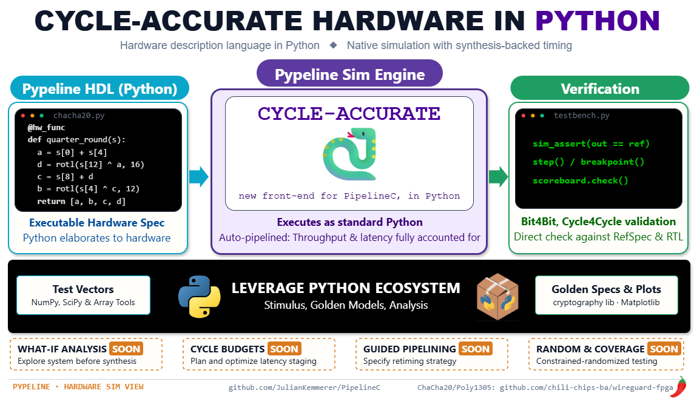

# pypeline_build — ChaCha20-Poly1305 AEAD in Pypeline

Pypeline (Python front-end for PipelineC) port of the C designs in
`../pipelinec_build/`. Three design variants target Artix-7
xc7a200tffg1156-2: **pipelined Poly1305 with hybrid Karatsuba multiplication
and specialized squaring, sharing both at 85 MHz by default**, or the
selectable **legacy Poly1305 at 80 MHz**. The C originals' Poly1305 math
and ciphertext-length bugs are fixed, so this port is RFC 8439-conformant and its
tags/ciphertext lengths deliberately differ from the (still-unfixed) C
designs (see "Test Vectors" below).

Each of the three design variants has **two testbench styles**: a
synthesizable-style testbench (fixed vectors, compiles through cocotb/GHDL or
real hardware) and a non-synthesizable testbench (`@sim_input`/`@sim_output`,
on-the-fly random vectors, native sim only) — see "Testbench Styles" below.

Combined builds share both ChaCha20 and the Poly1305 setup/finalization
resources by default. Sharing is independently selectable; standalone
encrypt/decrypt builds keep their compute resources private. Sharing-both
defaults to an **85 MHz** clock request; the accepted AUTO_FSM measurement
below explicitly targets **80 MHz**. Other pipelined selections retain their
**30 MHz** defaults. The default multiplier is `hybrid_square`.
Poly1305 setup and finalization now default to **AUTO_FSM** stream services;
`--poly1305-compute mcp` selects the previous AUTO_MULTI_CYCLE implementation
for both components. Both FSM cores use `max_latency=64`, with one additional
stream-wrapper cycle; the compiler chooses their schedules within that cap.
The measurements below identify their compute selection.

**Accepted AUTO_FSM QoR, 2026-10-18:** all **48 concurrent reference checks**,
body II=1, buffer conservation, final synthesis timing/device fit and archived
evidence checks passed. The design meets the **80 MHz** goal with
**81.037 MHz** limiting synthesis fmax. At 1920 bytes, payload goodput is
**9.125 Gb/s encrypt / 9.125 Gb/s decrypt at 80 MHz** (9.243 Gb/s each at fmax).
The shared performance-testbench top uses **413 DSPs, 104,668 LUTs,
93,372 FFs and 18.5 BRAM tiles**. Against the MCP baseline this saves
**41.9% DSPs and 3.2% LUTs**, while increasing FFs **112.4%** and reducing
1920-byte goodput **7.9%** at a common 80 MHz. See the
[full measurement and reproduction](measurements/shared-poly1305-fsm64-latest-qor-20261017/README.md)
and [complete comparison](measurements/shared-poly1305-fsm64-latest-qor-20261017/comparison.md).
The [accepted MCP baseline](measurements/shared-verify-fifo-qor-20261015/README.md)
and its verification-FIFO recovery results remain archived below.

Pipelined decrypt buffers ciphertext on its authentication fork, before
framing. Its memory depth is derived from the selected ChaCha pipeline's
credits, bounded setup and completion, then rounded to a power of two.
Pipelined encrypt also buffers ciphertext before authentication framing and
before tag append, so setup and completion can overlap adjacent packets.
With the measured FSM latencies, the required budgets are **145/496/340 beats**
for encrypt authentication/append and decrypt authentication, respectively:
**256/512/512 memory beats**, plus one output beat each. Plaintext verification
requires 477 beats and uses 512 memory beats plus one output beat. These are
derived storage budgets; resolved metadata and occupancy checks passed. See the
[sizing derivation](src/poly1305/throughput.md#latency-derived-overlap-fifo-budgets).
Pipelined encrypt retains a two-slot,
II=1 output register slice (one unstalled output cycle) to hold external AXIS
words stable under backpressure. Legacy has neither buffer. The
[recovery comparison](measurements/shared-60mhz-poly1305-pipelined-share-chacha20-poly1305-decrypt-recovery-20261005/comparison.md)
separates compiler-wrapper changes from the FIFO's measured benefit and
explains the scope of the remedy for
[Issue #39](https://github.com/chili-chips-ba/wireguard-fpga/issues/39).

<p align="center">
  
</p>

## Build Commands

Development simulation uses `--native`. Native simulation and synthesized QoR
are sufficient for development acceptance; do not routinely run generated-HDL
simulation or export final Verilog. Run one generated-HDL/GHDL check for the
selected design immediately before an explicitly requested final Verilog export.
Compiler rendering regressions belong in PipelineC's own test suite.

Run from `3.build/pypeline_build` in the primary WireGuard checkout. Set
`PYPELINEC` to `<PipelineC checkout>/src/pypelinec`, or put it on PATH.
`measure.py` and `bottleneck.py` also discover a sibling PipelineC
checkout (`../../../PipelineC`). Both repositories' revisions and
design-source hashes are preserved with each measurement. The accepted pre-overlap focused
85 MHz QoR used Vivado 2019.2 and an isolated PipelineC checkout at
`75a27b9fab2628d925e91b4b1bacab667917c976`, with matched latency memory.
The [accepted record and reproduction commands](measurements/shared-85mhz-bottleneck-1920-4pkt-20261013/README.md)
retain the design/compiler hashes, confirmed depths and synthesis evidence. Use the
archived source hashes for the exact tested code rather than assuming a
revision alone implies a clean tree.

Every build and measurement writes its own output directory under
`generated-files/` (ignored by git). Names include the build kind,
implementation, sharing selection and clock, so each profile keeps its own
output files. The shared synthesis store and latency memory reuse matching
results across profiles.

**Native Pypeline sim — non-synthesizable testbench (fastest to iterate on;
`@sim_input`/`@sim_output`, on-the-fly random vectors — see "Testbench
Styles" below):**
```bash
./build.py --enc --sim --comb --native     # Combinational sim, encrypt TB
./build.py --dec --sim --comb --native     # Combinational sim, decrypt TB
./build.py --shared --sim --comb --native  # Combinational sim, shared TB
./build.py --enc --sim --native            # Pipelined sim, encrypt TB (slow!)
./build.py --dec --sim --native            # Pipelined sim, decrypt TB (slow!)
./build.py --shared --sim --native         # Pipelined sim, shared TB (slow!)
```
These don't invoke GHDL/cocotb or generate real VHDL at all, and this
testbench style has no cocotb/GHDL equivalent (see "Testbench Styles" below
for why) — the `--native` (`--comb` or not) forms are the only way to run
it. Dropping `--comb` runs a real, cycle-accurate pipelined native
simulation: real autopipelining runs through the synthesis tool first to
discover each submodule's latency (like the pipelined cocotb/GHDL builds
below), then the native simulator emulates those latencies — which is what
makes it slow. Pass criteria: the build exits zero. This testbench prints an
`ERROR:` line for each mismatch (ciphertext/plaintext bytes, `keep` pattern,
packet framing, the tampered-tag packet's `is_verified_out`) and calls
`sim_finish()` once all packets are checked; an `@final(sim=True)` hook then
runs once, however the simulation ended, and asserts there were zero errors
and every packet was checked, so any failure exits non-zero — no eyeballing
console output for `ERROR`/`DONE` lines. The RNG seed in use is printed by an
`@initial(sim=True)` hook before the first cycle (`tb_common_sim.DEFAULT_SEED`
by default) so a failing run's exact vectors can be reproduced.

**Native Pypeline sim — synthesizable-style testbench (fixed vectors; no
cocotb/GHDL, Pypeline's own Python simulator):**
```bash
./build.py --enc --sim --syn_tb --comb --native     # Combinational sim, encrypt TB
./build.py --dec --sim --syn_tb --comb --native     # Combinational sim, decrypt TB
./build.py --shared --sim --syn_tb --comb --native  # Combinational sim, shared TB
./build.py --enc --sim --syn_tb --native            # Pipelined sim, encrypt TB (slow!)
./build.py --dec --sim --syn_tb --native            # Pipelined sim, decrypt TB (slow!)
./build.py --shared --sim --syn_tb --native         # Pipelined sim, shared TB (slow!)
```
The `--comb` forms are the quickest correctness check for the
synthesizable-style testbench while iterating on the `.py` sources. Dropping `--comb` here
runs the same real-autopipelining-first, cycle-accurate native simulation as
the non-synthesizable testbench above, without needing cocotb/GHDL at all —
useful for a cycle-accurate pipelined check that's still faster to iterate
on than the full pipelined cocotb/GHDL build. Pass criteria: the build exits
zero — every check is a `sim_assert(...)`, so a failure raises immediately.

**Final export check with cocotb + GHDL — synthesizable-style testbench only,
see "Testbench Styles" below. Run the selected design's pipelined check once
immediately before final Verilog export, rather than during development:**
```bash
./build.py --enc --sim --syn_tb --comb     # Combinational sim, encrypt TB
./build.py --dec --sim --syn_tb --comb     # Combinational sim, decrypt TB
./build.py --shared --sim --syn_tb --comb  # Combinational sim, shared TB (slow!)
./build.py --enc --sim --syn_tb            # Pipelined sim, encrypt TB (hours!)
./build.py --dec --sim --syn_tb            # Pipelined sim, decrypt TB (hours!)
./build.py --shared --sim --syn_tb         # Pipelined sim, shared TB (hours!)
```
Pass criteria: the build exits zero — every check in `tb_common.py`'s fixed
vectors (per side, one check per string in `PLAINTEXT_TEST_STRS`, plus one
extra decrypt-side check for the corrupted-tag negative packet, see "Test
Vectors" below) is a `sim_assert(...)` that elaborates to a real VHDL
`assert ... severity failure`, so a failing check halts the GHDL simulation
and the process exits non-zero. The pipelined (not `--comb`) variants run
real autopipelining through the synthesis tool first, which is what takes
hours.

**Final Verilog export — only when explicitly requested, after the HDL check:**
```bash
./build.py --enc      # Standalone encrypt
./build.py --dec      # Standalone decrypt
./build.py --shared   # Shared encrypt+decrypt
```

**Measure QoR** — fmax, area, throughput, latency; see "Measuring QoR" below.

### Design and sharing selection

| Selection (also accepted by `measure.py` for combined designs) | ChaCha20 shared | Poly1305 setup/finalization shared |
| --- | --- | --- |
| No sharing flags, or `--shared` | Yes | Yes |
| `--share-chacha20` | Yes | No |
| `--share-poly1305` | No | Yes |
| Both sharing flags | Yes | Yes |
| `--enc` or `--dec` (`build.py` only) | No | No |

A supplied sharing flag selects the complete set, not an extra resource added
to the default; `--share-none` builds the combined design with private
resources for each direction. Sharing flags cannot be combined with
`--enc`/`--dec`. Legacy combined builds require `--share-chacha20 --poly1305
legacy`: the implicit sharing-both default and `--shared` are rejected with
legacy.

| Hardware command | Default clock | Output directory |
| --- | ---: | --- |
| `./build.py` or `./build.py --shared` | 85 MHz | `generated-files/verilog-shared-poly1305-pipelined-share-chacha20-poly1305-mult-hybrid_square-compute-fsm-85mhz` |
| `./build.py --share-chacha20` | 30 MHz | `generated-files/verilog-shared-poly1305-pipelined-share-chacha20-mult-hybrid_square-compute-fsm-30mhz` |
| `./build.py --share-poly1305` | 30 MHz | `generated-files/verilog-shared-poly1305-pipelined-share-poly1305-mult-hybrid_square-compute-fsm-30mhz` |
| `./build.py --share-chacha20 --poly1305 legacy` | 80 MHz | `generated-files/verilog-shared-poly1305-legacy-share-chacha20-mult-inferred` |

An explicit
`--target-mhz N` overrides the profile clock with any positive integer MHz
target, including 5 MHz refinements and targets above 80 MHz. Acceptance of
a target is not a timing or capacity guarantee. Both
`build.py` and `measure.py` support `--poly1305 {pipelined,legacy}` (default
`pipelined`). Their clock defaults follow the selected implementation and
sharing set; `build.py --enc`/`--dec` default to 30 MHz. Only the chosen MAC
module is imported: the selector adds no hardware mux or unused legacy FSM.

`--poly1305-mult inferred|hybrid|hybrid_square` selects the pipelined MAC's 130-bit
multiplier at elaboration. `hybrid` uses PyPeline's Karatsuba factory with
threshold 34 and inferred leaves; the reducer and MAC architecture remain
unchanged. The default `hybrid_square` additionally specializes the
even-exponent prologue power calculations. Full-design 60 MHz synthesis uses
513 DSPs, versus 540 for hybrid and 704 for inferred, and meets timing.
It won the 60 MHz DSP comparison and its QoR measurement passed. The completed
70 MHz measurement delivers 6.483/6.500 Gb/s encrypt/decrypt at 1420 bytes,
using 576 DSPs. The completed 80 MHz measurement delivers 6.955/6.973 Gb/s
at 1420 bytes, with 711 of 740 DSPs and ten accumulator lanes per direction.
The automatic 90 MHz configuration exceeded DSP and LUT capacity. The completed
85 MHz refinement has the same area as 80 MHz and gives 7.390/7.409 Gb/s at
1420 bytes and 8.093/8.126 Gb/s at 1920 bytes. Those are the highest passing
pre-overlap rates; the overlap measurement below exceeds them. The default
target remains 85 MHz. These clock results are
synthesis timing, not routed timing closure. `inferred` is the only allowed
selection for legacy Poly1305. To reproduce the lower-resource checkpoint,
use `--target-mhz 60`; for the original arithmetic baseline, add
`--poly1305-mult inferred`. See the
[Poly1305 implementation and verification notes](src/poly1305/throughput.md#hybrid-karatsuba-and-explicit-squares).

At 1920 bytes, the dominant measured throughput cost before this change was
the sequential Poly1305 packet lifecycle: setup, body streaming, drain and
finalization occupied one context, holding the next key until IDLE.
The overlapped implementation addresses that dependency; the measured gains
and remaining shared-ChaCha/verification stalls are reported below. See the [baseline cycle breakdown](#interpretation-packet-lifecycle-at-1920-bytes).

### Karatsuba arithmetic and attribution

This configuration was inspired by FPGA-House-AG's
[ChaCha20Poly1305 DSP multiplier](https://github.com/FPGA-House-AG/ChaCha20Poly1305/blob/7e75c097af32429ff2c7979b976fe876efbdb9f3/src_dsp_opt/mul_136_kar.vhd)
and its [second Karatsuba level](https://github.com/FPGA-House-AG/ChaCha20Poly1305/blob/7e75c097af32429ff2c7979b976fe876efbdb9f3/src_dsp_opt/mul_68_kar.vhd).
Credit goes to that repository for the FPGA decomposition reference. The
WireGuard implementation reuses PyPeline's general unsigned Karatsuba factory;
no external VHDL was copied.

Two recursive levels turn a 130 × 130 product into nine inferred 32–34-bit
products. Vivado maps those to **36 DSPs**, versus 64 for a single inferred
wide multiply. The even-exponent prologue steps use explicit squares whose
small cross term is computed once and doubled; a 130-bit square uses **27 DSPs**.
The existing canonical reducer, lane recurrence, MCPs and packet controllers
remain in place. The legacy five-limb schoolbook routine is separate and was
not substituted into the pipelined datapath.

The library's ASIC-oriented defaults remain threshold 16 with shift/add leaves;
WireGuard opts into threshold 34 with pinned inferred leaves for exact
`uint130_t × uint130_t` products. Native simulation computes ordinary Python
products for overloaded `*`, so the focused generated-HDL checks also verify
the selected decomposition. See the [arithmetic design](src/poly1305/throughput.md#hybrid-karatsuba-and-explicit-squares)
for the candidate measurements, resource model and verification scope.

`--poly1305-compute fsm|mcp` selects both pipelined Poly1305 prologue and
epilogue services with one flag (default `fsm`). It applies to shared and
private services in `build.py` and `measure.py`; direct `pypelinec` builds use
`-D POLY1305_COMPUTE_IMPL=fsm|mcp`. FSM mode uses
[`make_stream_auto_fsm`](../../../PipelineC/docs/pypeline_guide.md#stream-wrapper-for-auto_fsm-make_stream_auto_fsm-experimental)
with automatic scheduling and no starting latency or latency limit. Both modes
keep the same valid/ready interface, round-robin sharing and body pipeline.
FIFO budgets use the selected compute latency plus the wrapper's one result
cycle. Historical metadata keys `*_mcp_latency` and `shared_mcps` are retained
in measurement JSON for compatibility; `compute_impl` identifies their mode.
Legacy Poly1305 is unaffected by this pipelined-only selection.

Both epilogues select powers through loops of constant-index reads. This
works around PipelineC's [AUTO_FSM variable-index read issue](../../../PipelineC/docs/issues_inventory.md#29-tbd-auto_fsm-cannot-regenerate-a-variable-index-array-read),
which otherwise keeps the entire epilogue as one operation too slow for the
clock goal. The loops preserve the lane rotation and allow automatic scheduling
to split the epilogue across states; final timing still requires synthesis.

`build.py` turns these flags into PipelineC design parameters on the
`pypelinec` command line (`-D DESIGN=encrypt|decrypt|shared`, `-D
POLY1305_IMPL`, `-D POLY1305_MULT_IMPL=inferred|hybrid|hybrid_square`,
`-D POLY1305_COMPUTE_IMPL=fsm|mcp`,
`-D SHARE=none|chacha20|poly1305|both`, `-D TARGET_MHZ`), all
declared in [src/wireguard_env.py](src/wireguard_env.py). A direct `pypelinec`
run takes the same parameters and resolves the same profile defaults, so it
builds exactly what `build.py` would; for example the decrypt hardware at its
default 30 MHz:

```sh
pypelinec ./src/chacha20poly1305.py --top chacha20poly1305_decrypt --verilog -D DESIGN=decrypt
pypelinec ./src/chacha20poly1305.py --list_params   # every parameter, its choices and default
```

`build.py -D NAME=VALUE` passes any other design parameter through (the
stress and performance knobs below).

Output directory names carry the implementation, sharing, multiplier and compute selections and,
except for the historical 80 MHz naming, the clock suffix — for hardware and
every simulation mode. Separate encrypt/decrypt variants passed the
integration tests; the archived DUT-only area is for shared.

Implementation details and standalone unit testbench commands are documented
in the [Poly1305 design](src/poly1305/throughput.md#standalone-testbenches).
`build.py` only selects the encrypt, decrypt, or shared top, with the existing
hardware, correctness-testbench and shared-performance modes.

### Automatic latency memory

Automatic pipelines and MCPs have named latency groups; AUTO_FSM services
use the wrapped function's identity. The small
`poly1305_body_encrypt` / `poly1305_body_decrypt` wrappers keep `poly1305_body`
inside each region, where the sweep can attribute its critical paths and
mini-sweep it. Direct imported-function tagging currently has weaker
attribution, and region roots are not mini-swept; see PipelineC's
[known issue and wrapper workaround](../../../PipelineC/docs/issues_inventory.md#35-not-yet-filed-auto_pipelinef-on-an-imported-function-sweeps-worse-than-a-wrapper).

PipelineC discovers, remembers and restores the automatic depths. A build
with no usable memory runs the normal sweep and records its results.
Latency-dependent storage follows the actual discovered depth.
Pipeline values count core registers, excluding I/O registers; MCP values
count setup cycles, excluding the handshake cycle.

All profiles and latency memory are tool-generated outputs under
`generated-files/`:

| Output | Purpose |
| --- | --- |
| `<build directory>/latency_profile.json` | Reports the built depths/counts and whether their owning MAINs met timing. |
| `<build directory>/latency_memory.json` | Remembers verified depths, MCP counts, mini-sweep locks and MAIN implementations. |
| `syn_cache/latency/v2/<tool>/<part>/<kind>/` | Shared verified pieces, reused across build directories. |

The shared store is a sibling of the per-build output directories, so
`build.py` can clear one build directory without deleting its store copy.
`--continue` also retains the build-local memory. Use the same absolute
`--syn-cache` path to share results between separate working directories.
Unchanged hardware at the same goal restores its matching results; a higher
goal can start from the highest lower-goal result. Higher-goal results never
seed a lower goal, and stale hardware pieces
are ignored before synthesis. Replayed implementations receive a confirmation
synthesis; when consumed and built latencies agree, the pin-and-confirm
second pass is skipped.

PipelineC writes and loads memory automatically.
Remembered values seed the sweep, with the compiler's lower-goal floors;
every reused implementation is confirmed by synthesis. They never change tag
identities or entity names.
The compiler must support named AUTO tags and schema-2 latency memory; see
its [latency-memory guide](../../../PipelineC/docs/pypeline_guide.md#starting-latencies-the-latency-memory-and---latency_hints).

Use `--out-dir` to compare a fresh build without disturbing the previous cache:

```sh
./build.py --shared --target-mhz 30 -j 1 \
  --out-dir generated-files/shared-30mhz-check
```

An explicitly selected output directory must be empty for a fresh build;
`--continue --out-dir ...` resumes it without clearing files. Keep separate caches
when comparing clock and hardware profiles.

### Clock declarations

Every design and testbench `@MAIN` declares `wireguard_env.TARGET_MHZ`,
including simulation finish checkers. A bare checker whose `@sim_output`
call disappears during hardware elaboration has no shared wires from which
the compiler can infer its clock. Previously this produced an unused
`clk_None` top port and a fallback 1000 MHz constraint. The historical recovery
HDL contains that name only in the port declaration; Vivado reports the port
as unconnected and zero register pins without clocks. Explicit rates remove
the phantom clock. The fresh 60 MHz build has only `clk_60p0`, no missing-frequency
warning, zero unclocked register pins, and zero unconstrained internal pins.

### Acceptance testing

The overlap change passed the three basic combinational native benches and
one shared pipelined performance replay with four packets per size/direction
at 1420 and 1920 bytes. All 16 pipelined packet results, ownership assertions,
buffer conservation, II=1 and retained synthesis timing/fit checks passed.
The synthesis target was 80 MHz with 85.543 MHz reported effective fmax.
See the [accepted overlap record](measurements/shared-poly1305-overlap-resume-20261015/README.md).

The following integration/fallback matrix documents earlier qualification;
it is not the test scope for the overlap checkpoint (stop on the first
failure):

```sh
set -e
for design in enc dec share-chacha20; do
  ./build.py --"$design" --sim --comb --native --continue
  ./build.py --"$design" --sim --comb --syn_tb --native --continue
  ./build.py --"$design" --poly1305 legacy --sim --comb --syn_tb --native --continue
  ./build.py --"$design" --sim --native --continue -j 1
  ./build.py --"$design" --sim --syn_tb --continue -j 1
done
```

Earlier sharing and buffering qualification used both native testbench styles for standalone enc/dec
and all three sharing configurations, plus a legacy ChaCha-only smoke test.
The component's directed sharing test is documented separately. The sharing-both
60 MHz native synthesis-backed testbench passed 10 encrypt and 11 decrypt
fixed-vector tests. For the decrypt-buffering change, 11 native combinational
builds passed 205 packet checks across the selections/styles and legacy smoke;
the sharing-both stress run passed 16 encrypt and 17 decrypt checks. The
earlier six-size QoR passed all 48 reference-checked packets at its converged
depths. Automatic sizing and explicit clocks also passed the 11-case native
matrix, AAD boundaries at 0/1/16/17/32 bytes, and the stress case. A matched-depth
comparison with explicit 64-beat storage passed 32 packet checks and retained
identical goodput at 1420/1920 bytes. The current multiplier/profile validation
is documented in the [Poly1305 verification notes](src/poly1305/throughput.md#verification-and-reproduction); the earlier
[recovery record](measurements/shared-60mhz-poly1305-pipelined-share-chacha20-poly1305-decrypt-recovery-20261005/workflow-evidence.json)
preserves the original buffering qualification. These historical matrix runs
were not repeated for the multiplier sweep.

The random native testbenches also support `-D TB_STRESS=1`. This selects
16 directed packets through 1920 bytes, input gaps and prolonged/periodic
output backpressure (plus decrypt's tampered-tag packet). Sources present
words in `@sim_input` but commit only converged handshakes in `@sim_output`;
sinks count only `valid && ready` and assert that a stalled output's data,
keep, last and verification status remain stable. The performance testbench
does **not** use these pauses.

```sh
./build.py --shared --sim --comb --native --continue -D TB_STRESS=1
```

`--continue` keeps the selected output directory; `measure.py --reuse-syn`
gives measurements the same behavior. Builds from this working directory
also share the synthesis store
`generated-files/syn_cache` (`build.py --syn-cache DIR|none`): a run whose exact
synthesis inputs were already synthesized for any profile or output directory
is reused instead of re-run, so a cleared output directory or another clock
profile pays only for what actually changed. A reused run restores its log, not
its Vivado checkpoint (`.dcp`); build into a fresh output directory with
`--syn-cache none` when you need one. An empty store still requires synthesis.
The default store path is relative to the working directory. Builds from
separate source copies must select the same absolute `--syn-cache` path to
share results. When calling `measure.py` from a separate source copy, point its
default `generated-files/syn_cache` at that common store as well. Changing HDL,
constraints, device or tool recipe still
requires synthesis when no matching entry exists.
Hardware and pipelined simulation builds pass `--stop_on_over_capacity`.
Use `-j 2` for the default FSM builds on the 16 GB development machine.
MCP builds can still need `-j 1` on low-RAM systems. This limits concurrent
vendor-tool jobs, including automatic MCP characterization, but does not
limit Vivado's internal threads or the compiler's scheduling memory.

Build outputs and scratch logs are local work files. For background synthesis:

```sh
nohup ./build.py --shared --continue -j 2 \
  > /tmp/wireguard-shared-build.log 2>&1 < /dev/null &
```

Keep retained local regression records under `generated-files/` alongside
their build outputs. `measure.py --label "$(pwd)/generated-files/<record>"`
places its JSON, CSVs, summaries and logs there. Durable published measurement
archives remain under `measurements/`.

After an interruption, inspect the precise failing vendor log. Rename only an
identified incomplete/error cache log before using `--continue`; preserve good
synthesis caches and do not restart the long sweep unnecessarily. A source or
compiler change requires reviewing whether those cached observations still
match the design; continuation is not permission to ignore source drift.

Changing the clock uses the ordinary `--target-mhz` option; there are no
special diagnostic builds or hidden shared-clock overrides. Generic compiler
regressions belong in PipelineC's own suite, not a WireGuard test-runner directory.

### Primitive cache troubleshooting and compiler follow-up

The compiler's scalar operator-delay cache and the synthesis-log store serve
different purposes. A valid exact `.delay` in the selected PipelineC checkout's
`cache/delay/<backend>/<part>/<syn-or-pnr>/` namespace bypasses zero-clock
characterization entirely. A backend attempt after a scalar miss can still
reuse an exact output-directory or synthesis-store observation. A queued
"Synthesizing function" message does not establish that Vivado was launched;
the backend's `Running:` message does.

The October 12 investigation, audited against PipelineC
`4687e2749b682a8c80e24f5d7f2cd21843e1f507`, established:

- `BIN_OP_PLUS_uint32_t_uint33_t.delay` was absent from the selected cache.
  Its reversed-operand key existed at 2.342 ns, but the two keys are distinct.
  There were 23 binary-operator cache hits and 16 scheduled operators; none
  of those 16 had an exact entry in the initial cache inventory.
- The exact adder had an earlier synthesis-store observation. Reuse missed
  because the unused `pipelinec_fifo_fwft.vhd` changed. Adder HDL, registered
  wrapper, scoped type package, async FIFO, fixed-point package, constraints,
  part and Vivado version all matched.
- Recomputing both `VIVADO.INPUT_MANIFEST` records reproduced their signatures.
  Substituting only the earlier sync FIFO input reproduced the entire earlier
  manifest. The scalar-cache scheduling branch also passed exact-hit,
  scalar-only and zero-delay fixtures; removing the file reached the guarded
  scheduling branch. No vendor tool was needed for those checks.

**The compiler dependency fix is still separate work.** Work within one
PipelineC checkout. Preserve the existing exact-cache fast path, narrow unused
built-in HDL dependencies, and make misses understandable. Operand-order
aliases are optional. Retaining warm caches across frozen checkouts is outside
this fix's scope; no WireGuard datapath change is needed.

Relevant PipelineC entry points:

| Entry point | Responsibility |
| --- | --- |
| `SYN.GET_CACHE_ROOT_DIR` / `GET_PATH_DELAY_CACHE_DIR` | Cache root override and backend/device/recipe/planner namespace. |
| `SYN.GET_CACHED_LOGIC_FILE_KEY` | Exact operator key, special MUX handling and filename-length cap. |
| `SYN.GET_CACHED_PATH_DELAY` / `GET_CACHED_PATH_DELAY_COMPONENTS` | Scalar measurement and optional timing-component sidecar. |
| `SYN.ADD_PATH_DELAY_TO_LOOKUP` | Cache lookup before deciding to schedule characterization. |
| `SYN.SET_MEASURED_DELAY_FROM_REPORT` | Persists actual measured delays. |
| `SYN.GET_VHDL_FILES_TCL_TEXT_AND_TOP` | Actual HDL read set shared by synthesis and export. |
| `VIVADO.INPUT_MANIFEST` / `SYN.SYNTHESIS_INPUT_MANIFEST` | Input and recipe identity. |
| `SYN.CHECK_VHDL_FILES_CONSISTENCY` | Referential consistency of emitted HDL files. |

The required implementation is:

1. Replace the unconditional sync/async FIFO inclusion in
   `GET_VHDL_FILES_TCL_TEXT_AND_TOP` with one shared dependency helper. Inspect
   rendered reachable HDL, including nested raw-VHDL bodies and generated
   clock-crossing entities. A map for the two built-in FIFO units is sufficient.
   Match names case-insensitively, preserve direct entity/architecture and
   supported component/binding forms, and strip comments and string literals.
   Follow transitive built-in references, deduplicate, and use deterministic
   dependency order. Then run the existing scoped type-package step.
   Change the actual backend/export read set and hash every actual input;
   removing hashes while still reading an unused file would hide a dependency.
   Keep required standard-library, fixed-point, global-wire and type-package
   inputs, real FIFO dependencies, and consistent final `vhdl_files.txt` output.
2. Add scheduler-level tests around the real cache lookup and scheduling
   decision. Stub only unrelated hierarchy/HDL/report setup and use an
   `apply_async` guard that fails if characterization is scheduled. Test exact
   valid `.delay`, scalar-only legacy entries and `0.0` as hits; missing entries
   as a negative control; wrong part/backend/`pnr` namespaces; explicit
   `PYPELINEC_CACHE_DIR`; and the existing user-overload exclusion. Vivado must
   not require a timing sidecar or area cache for a valid scalar hit. Preserve
   DEVICE_MODELS' existing timing-component/area completeness rules and mutable
   soft-operator policy. Estimated delays must not become measured entries.
3. Print the selected delay-cache directory once and report exact keys and
   miss reasons. Distinguish backend attempts from actual vendor launches.
   Store misses should identify the signature and differing inputs when an
   earlier manifest is already available, without scanning the full store
   on every lookup. Preserve old observations; do not manufacture signatures
   or rewrite manifests to make mismatching logs appear reusable.

Add `primitive_delay_cache_test.py` and `builtin_vhdl_dependencies_test.py`
under `src/tests/pypeline_tests/inst/`, registering them in `unit_tests.py`.
The dependency tests must cover a scalar adder with neither FIFO, unchanged
adder identity after an unused FIFO edit, real sync/async and nested raw-HDL
dependencies, mixed-case names and architecture/component forms, comment or
string-only mentions, transitive closure, deterministic ordering across hash
seeds/output paths, and invalidation after a used input/constraint/device/tool
change. The tests should run in process without invoking Vivado or its version
command. Retain relevant `device_models_sta_test.py` and `area_model_test.py`
coverage. Existing `generated_vhdl_stability_test.py` provides helper coverage;
`syn_cache_test.py` also invokes backend builds when run directly, so select
its in-process checks separately for the initial focused verification.

After focused tests pass, one minimal 85 MHz QoR check is sufficient if hardware
verification is needed (see [verification and reproduction](src/poly1305/throughput.md#verification-and-reproduction)).
Require timing, fit and native packet acceptance, and verify that exact valid
operator-cache entries schedule no characterization. Final design timing/area
and newly sliced implementations still require their real synthesis inputs.
Update PipelineC's `docs/SYN_DESIGN.md` with the dependency policy and diagnostics.
No additional clock/design matrix or Verilog export is required.

The retained observations are in
`generated-files/syn_cache/v1/vivado/<signature prefix>/<signature>/`
as `manifest.json` and `log`. Their signatures are:

| Observation | Signature |
| --- | --- |
| Earlier | `be9a5862a15d6dcaaeac465d5bb754d6863dc3a16a65b9f5253bed4eba0f9797` |
| October 12 | `5c6db1d0a03fd199175e37e0635c87f46bedb67d90927d04d042f18b2dfa3387` |

The manifest summary and normalized recipe/FIFO diffs are retained under
`generated-files/primitive-cache-investigation/`. The unchanged adder/wrapper
hashes and sole changed input are recorded here so the finding remains readable
without local build outputs:

| Input | SHA-256 |
| --- | --- |
| Adder, both observations | `1dda5bc0aa2c2850b239cbf55a0b8c79a941046801a018922cde989a7d05a681` |
| Registered wrapper, both | `a87f382e5c2a7f63e2c40d9b4e241599d8d6a508eb6d3dfbcc6d8c19d361e21f` |
| Sync FIFO, earlier | `2dec640ba6051c83feb062f81ab7479c52cdccb0bc946c1a582b3601ee1edf5f` |
| Sync FIFO, October 12 | `1e30cb3d4429bd947931d3290ca003690579d7f2c2ee55a6280678f29991a097` |

An optional later operand-alias optimization must preserve exact-key precedence
and legacy entries, validate unsigned arithmetic/result widths, keep HDL entity
identities independent of aliases, and test signedness, noncommutative operators,
sidecar provenance and conflicting exact measurements separately.

## Source Layout (mirrors ../pipelinec_build/src/)

```
src/
  wireguard_env.py              sys.path bootstrap; the build parameters (-D DESIGN,
                                 POLY1305_IMPL, SHARE, TARGET_MHZ) and the profile they
                                 select; starting latencies; output-directory naming
                                 (plain Python, also imported by build.py/measure.py)
  aead_types.py                 shared sizes/types, latency-derived fork FIFOs and output slices
  chacha20/
    chacha20.py                 ChaCha20 math + pipeline-control FSM + chacha20_instance
                                 (FSM and stream pipeline merged into one function; chacha20.h)
    chacha20_pipeline_shared.py the one shared pipeline + round-robin mux, merged into one
                                 function, plus chacha20_encrypt_shared/chacha20_decrypt_shared
                                 (the shared design's per-direction instances that read/write
                                 this file's Wires — chacha20_pipeline_shared.c)
  poly1305/
    poly1305.py                 selectable legacy MAC FSM + MCP (poly1305.h)
    poly1305_math.py            shared corrected limb and 130-bit-residue arithmetic
    poly1305_mac_pipelined.py   prologue, two-bank II=1 body and epilogue stages
    poly1305_mcp_shared.py      independent tagged prologue/epilogue round-robin services
    poly1305_select.py          conditional import and per-direction metadata
    poly1305_verify_decrypt.py  tag comparison FSM
  prep_auth_data/
    prep_auth_data.py           AAD||ciphertext||lengths framing FSM (prep_auth_data_fsm,
                                 called directly by both directions; prep_auth_data.h)
  auth_tag/
    append_auth_tag.py          merge tag into ciphertext's final beat + a tag-tail beat
                                 (encrypt output; Xilinx-style packed framing, issue #44)
    strip_auth_tag.py           reassemble the tag from the last two input beats
                                 (decrypt input, early-tlast buffer; issue #44)
    wait_to_verify.py           sized plaintext FIFO + wait-for-verdict FSM factory
                                 (pipelined automatic sizing, legacy 128 memory beats)
  chacha20poly1305/
    chacha20poly1305_encrypt_ports.py   DUT-facing global wires (the .h wires)
    chacha20poly1305_encrypt_hw_io.py   flattened Input[]/Output[] ports + io conversion MAIN
    chacha20poly1305_decrypt_ports.py / chacha20poly1305_decrypt_hw_io.py
    encrypt_dataflow_core.py / decrypt_dataflow_core.py   make_encrypt_dataflow_core /
                                 make_decrypt_dataflow_core: factories returning the direct-call
                                 dataflow graph, parameterized by ChaCha20 instance and optional
                                 MAC instance (see "Wiring Style" below)
    encrypt_dataflow.py / decrypt_dataflow.py            wiring MAINs (selected clock):
                                 instantiate the factory with the private or shared ChaCha20
                                 and MAC resources -D SHARE selects
    tb_common.py                 synthesizable-style testbench's fixed 10-string vectors,
                                  computed once at elaboration time
    tb_common_sim.py             non-synthesizable testbench's shared support: fixed
                                  KEY/NONCE/AAD, random lengths, stress pauses, and the
                                  converged AXIS source/sink (PipelineC axi/axis_sim.py)
                                  (no precomputed vectors — those are generated lazily,
                                  per packet, during simulation)
    aead_ref_model.py            pure-Python (no pypeline/hardware dependency) reference
                                  model both tb_common.py and tb_common_sim.py call to
                                  generate vectors — see "Test Vectors" below
    encrypt_syn_tb.py / decrypt_syn_tb.py   synthesizable-style testbench MAINs (fixed
                                  vectors, cocotb/GHDL/pipe-compatible)
    encrypt_tb.py / decrypt_tb.py           non-synthesizable testbench MAINs
                                  (@sim_input/@sim_output, on-the-fly random vectors,
                                  native sim only) — see "Testbench Styles" below
    perf_tb_common.py            the phase plan + -D PERF_* knobs + frame builders, the
                                  MAIN-to-direction tap labels, and the shared barrier/
                                  recorder/runners from PipelineC's stream_perf library
    encrypt_perf_tb.py / decrypt_perf_tb.py  performance testbench MAINs: stream the phase plan
                                  with zero source gaps and measure, while still checking every
                                  packet against the reference model (native sim only)
  chacha20poly1305.py / _tb.py / _syn_tb.py / _perf_tb.py   tops (hw / sim non-synth / sim synth /
                                 perf), each for -D DESIGN=encrypt|decrypt|shared
  poly1305_pipelined_syn_tb.py  standalone pipelined-MAC testbench top (see throughput.md)
```

Measurement tooling lives next to `build.py` rather than under `src/` (it is not
part of any design):

```
build.py         --perf selects the performance testbench (implies --sim --native)
measure.py       the QoR orchestrator: build+sim, parse fmax/area, merge, emit JSON/CSV/md
bottleneck.py    WireGuard's block graph, Poly1305/ChaCha20 cost model and report wording
                 over PipelineC's stream_bottleneck (--selftest included)
                 Vivado utilization, MCP HDL audit and evidence integrity live in measure.py
measurements/    one directory per measured point (results.json, summary.csv, blocks.md, …)
generated-files/ build and measurement caches, one directory per configuration (ignored)
```

## Testbench Styles: Synthesizable vs Non-Synthesizable

Each of the three design variants has two independent testbenches, sharing
the same DUT-facing `*_ports.py` wires but differing entirely in how
stimulus is generated and outputs checked:

- **Synthesizable-style** (`encrypt_syn_tb.py`/`decrypt_syn_tb.py`, driven by
  the `_syn_tb.py` tops): a `@MAIN` hardware state machine streams/checks a
  fixed batch of test vectors — 10 plaintext strings, chosen to cover the
  partial-final-word and block-boundary corner cases — computed once via
  `aead_ref_model.py` at elaboration time and baked into fixed-size
  `Reg[uint8_t[N]]` hardware register arrays (`tb_common.py`). Because this
  testbench is itself synthesizable Pypeline, it can run through cocotb+GHDL
  against real generated VHDL, or through real autopipelining (pipelined,
  not `--comb`, builds) for the check immediately before final Verilog export.
- **Non-synthesizable** (`encrypt_tb.py`/`decrypt_tb.py`, driven by the plain
  `_tb.py` tops): uses Pypeline's `@sim_input`/`@sim_output` decorators to
  generate stimulus and check outputs as arbitrary Python, live,
  cycle-by-cycle during simulation. Each run generates 12 random-length
  (1-1024 byte) packets per direction on the fly — a few pinned to the same
  corner-case lengths as the fixed vectors, the rest uniform-random — calling
  `aead_ref_model.py` lazily, once per packet, right when that packet's
  random plaintext is generated (`tb_common_sim.py`), rather than batching
  everything up front. No fixed-size arrays, no elaboration-time
  pre-baking — packets can be any length. The decrypt side adds a 13th
  packet with a deliberately bit-flipped tag (reject-path coverage,
  mirroring the synthesizable variant's fixed tampered-tag packet). The RNG
  is seeded by default (`tb_common_sim.DEFAULT_SEED`) and the seed is printed
  at the start of each run, so a failing run's exact vectors are
  reproducible.

  `@sim_input`/`@sim_output` calls are entirely invisible to the hardware
  elaborator — skipped unconditionally, whether or not `--sim` is passed —
  so this style **only runs under Pypeline's native `--sim` mode**. Routing
  it through `--cocotb --ghdl` would first generate real VHDL with every
  `@sim_input`/`@sim_output` call site stripped out, leaving no stimulus
  generation or output checking left anywhere — there is no cocotb/GHDL
  variant of this style, `--native` is the only way to run it. Native sim
  does support a pipelined (not `--comb`) run of this style, though, via
  real autopipelining through the synthesis tool followed by native
  latency-emulated simulation (see "Build Commands" above) — no cocotb/GHDL
  needed. Use this style for fast iteration and broader random coverage; use
  the synthesizable style for the GHDL check before final Verilog export.

## Native vs VHDL Cycle-Accuracy Check (`pypeline_sim_debug.py`)

This is a compiler diagnostic, not a routine WireGuard development check.
Development relies on the native simulator's hardware model; compiler
native-versus-HDL regressions should be checked in PipelineC's own suite.

`encrypt_syn_tb.py`/`decrypt_syn_tb.py` tag their per-word data prints —
each 16-byte chunk of input plaintext/ciphertext and output
ciphertext/plaintext — with `sim_print(..., debug=True)`. Each tagged print
sits inside the same `valid & ready`-gated, register-driven block that
drives the rest of that testbench's checking logic, not inside any
pipelined combinational region, satisfying `pypeline_sim_debug.py`'s rules
for probes used in a pipelined (non-`--comb`) compare.

This lets the pipelined syn_tb builds be run through `pypeline_sim_debug.py`
that compares the native
latency-emulated simulation against the real cocotb+GHDL VHDL simulation —
both post-autopipelining, cycle by cycle:

```bash
pypeline_sim_debug.py ./src/chacha20poly1305_syn_tb.py --sim --run all -D DESIGN=encrypt
pypeline_sim_debug.py ./src/chacha20poly1305_syn_tb.py --sim --run all -D DESIGN=decrypt
pypeline_sim_debug.py ./src/chacha20poly1305_syn_tb.py --sim --run all -D DESIGN=shared
```

Each run does a full synthesis build first (both the native and VHDL sides
need the real, discovered pipeline latencies), then diffs the two runs'
`debug=True`-tagged lines cycle by cycle, reporting the first cycle where
they disagree. Agreement here confirms the native simulator's emulated
per-stage latencies actually match the real autopipelined VHDL timing, not
just that both eventually produce the same final output — a check the
ordinary `sim_assert`-based pass/fail criteria above can't provide on their
own, since assertions on final output data don't catch a data word arriving
correct but on the wrong cycle.

## Measuring QoR (fmax, area, throughput, latency)

The point of this design is to get *faster, smaller, lower latency*, so those
three have to be measurable in one automated, repeatable step rather than
eyeballed per change. `./measure.py` is that step: it produces one
machine-readable record per design variant, and the next variant's record diffs
against it directly.

The design-agnostic half of this tooling — the in-design probes, the
boundary meter and phase runner, the bottleneck rollup and the report math — is
PipelineC's stream performance library; its
[guide](https://github.com/JulianKemmerer/PipelineC/blob/master/include/pypeline/stream/pypeline_stream_perf_guide.md)
defines every metric and probe rule. This repo adds the AEAD block graph, the
Poly1305 cost model, Vivado fmax/area parsing, acceptance checks and evidence.

The accepted AUTO_FSM measurement uses the shared pipelined design with
64-cycle caps on both Poly1305 service cores and an 80 MHz goal. The compiler
chose 64-cycle prologue and 41-cycle epilogue cores, each with one additional
stream-wrapper cycle. It used a verified copy of the primary PipelineC working
tree at `8ed96ba4` plus its uncommitted updates. The
[measurement archive](measurements/shared-poly1305-fsm64-latest-qor-20261017/README.md)
records the exact compiler patch and source hashes. Reproduce with that copy:

```bash
export PYPELINEC="$PWD/generated-files/poly1305-fsm-compiler-attempt8-latest/compiler/src/pypelinec"
export PYPELINEC_CACHE_DIR="$PWD/generated-files/pypelinec-cache"
./measure.py --shared --poly1305 pipelined --target-mhz 80 \
  --poly1305-mult hybrid_square --poly1305-compute fsm -j 2 \
  --label shared-poly1305-fsm64-latest-qor-20261017 --reuse-syn \
  --out-dir generated-files/shared-poly1305-fsm-qor-20261016 \
  --sizes 16,64,256,1024,1420,1920 --packets 4 --peak-bytes 0 \
  --dirs both --taps all --seed 8439 --no-per-module-area --save-evidence
```

For a focused bottleneck investigation near the maximum packet size, use
`--sizes 1920 --packets 4 --peak-bytes 0`. This selects one back-to-back phase
with four packets per direction; `--peak-bytes 0` disables the extra peak
phase. Keep `--dirs both --taps all` for concurrent traffic and the internal
FSM, stall and arbitration counters. Four packets provide three completion
intervals and enough lifecycle samples to identify packet overhead. Use
`--packets 16` when a longer sustained-rate/contention window is needed.
Use a pipelined run (omit `--comb`) so the cycle budget includes the automatic
pipeline and MCP depths of the selected clock profile.

Read `summary.md` for payload goodput and packet-completion periods, and
`blocks.md` for the bottleneck verdict and Poly1305 lifecycle breakdown.
The MAC input's service period includes packet-boundary backpressure;
`poly1305.to_compute` measures body service while work is offered. The
lifecycle table separates setup, body, drain, finalization and tag output.
Its IDLE count includes key waits and phase-settle time, and tag stalls are
already included in tag-output time. These MAC-local costs are separate from
whole-datapath latency.
The automatic block verdict follows payload edges. Also inspect the
`chacha20.key_out` / `poly1305.key_in` taps: the MAC accepts a new packet key
only in IDLE, and a stalled key holds ChaCha's next-packet output. This key
dependency is outside the payload-only block rollup.

This reports perf-top area/timing only. Add `--area-from-dir <hardware out_dir>`
only after the external-port hardware top has independently passed at the
same goal. Other forms:

```bash
./measure.py --label X --reuse-syn         # remeasure, reusing valid synthesis inputs
./measure.py --label smoke --comb          # rig check in minutes (no Vivado, no area/fmax)
./measure.py --label X --parse-only        # re-merge an existing run's outputs
./measure.py --label X --sizes 64,1420 --packets 8 --peak-bytes 1920
./measure.py --label X --out-dir generated-files/perf-X # isolated fresh cache
./measure.py --label X --taps poly1305      # only the MAC's internal taps
./measure.py --label X --taps ''            # boundaries only, no internal taps
./measure.py --selftest                   # area, acceptance, model and archive checks
./bottleneck.py --selftest                 # block attribution + model math check
./bottleneck.py measurements/X/results.json  # re-print a run's block tables
./build.py --shared --perf [--comb]        # the underlying build/sim on its own
```

The metric math itself is regression-tested in PipelineC
([`stream_perf_test.py`](https://github.com/JulianKemmerer/PipelineC/blob/master/src/tests/pypeline_tests/inst/stream_perf_test.py)
and its probe/testbench siblings). Use a new label for a new architecture;
`shared-80mhz` and `shared-80mhz-probed` are retained legacy snapshots.

One `./measure.py` run is one `pypelinec` command line (`./build.py --shared
--perf`): it autopipelines the design for its selected clock goal through Vivado,
then runs the **native** simulation of exactly what it built, with the
discovered per-stage latencies modeled — no cocotb/GHDL needed. So fmax, area,
latency and throughput all describe the same build, and cannot drift apart.

Failed/incomplete runs retain diagnostic artifacts but cannot replace README
results or return measurement success. Non-combinational measurements require
both timing and area evidence, and audit the selected MAC's emitted
arithmetic; `--area-from-dir` also requires a confirmed hardware-top timing
pass and available DUT-only area. Timing/capacity acceptance uses each top's
own confirmed report, never hardware timing in place of perf-top timing. Known
resource over-capacity, inconsistent tap cycle counts or inconsistent buffer
occupancy fail the measurement, even if a synthesis-only timing estimate
passes. `results.json` records these checks under `validation`.
`--parse-only` retains saved build provenance and DUT-only area when
regenerating reports.

`--save-evidence` packages retained hardware/perf logs, input manifests,
sweep histories, frozen design/include source hashes when available,
hash-matched constraints and an artifact checksum inventory
into the measurement directory. Use a fresh label; committed records
remain historical evidence. Check one without rewriting it:

```sh
./measure.py --check-record measurements/shared-60mhz-auto-auth-fifo-explicit-clocks-20261006
```

### What is measured, and how

- **fmax + pipeline depth** come from pypelinec's own numbers, not a
  reimplementation: the per-MAIN **`final` records** in
  `<out_dir>/<top-name>/sweep_history.json` (schema 3, with schema 2 supported;
  default name `top`). They describe the design as
  built, after any pin-and-confirm confirmation run, restored best/met
  snapshot or as-written check. The build's printed outcome lines
  (`met timing, N slice(s) built …`,
  `synthesized as written (standalone check): X MHz vs Y MHz goal - PASS`,
  `PASS <main>: X MHz … (confirmation run)`, `TIMING NOT MET …`) are parsed
  only as a cross-check, and any disagreement is listed under
  `fmax.source.cross_check_mismatches`. `fmax.source.final_basis` says which
  source was used. An older schema-1 history is only an iteration log that
  could stop before the iteration that met timing, so for those the printed
  lines stay authoritative and the log's last entry is kept, clearly labelled,
  under `fmax.per_main[*].last_sweep_iter.mid_sweep_mhz`.
  When a MAIN meets its goal but no MHz was ever measured for it (no failing
  timing path named it), its `final` record has `achieved_mhz: null` and
  `mhz_is_lower_bound: true`. Its exact fmax is unknown and the goal is only a
  *lower bound*: `design_mhz` is then the goal, with
  `design_mhz_is_lower_bound: true`, a `design_mhz_basis` string saying why, and
  `min_reported_mhz` carrying the lowest MHz actually measured.
  `limiting_main` names the MAIN that set the number.
- **area** comes from `report_utilization` in that build's Vivado log, parsed by
  this repo's own parser in `measure.py` — LUTs (logic vs memory vs SRL/DRAM), FFs,
  DSP48s, BRAM (tiles / RAMB36 / RAMB18) and CARRY4 all kept separate.
  PipelineC's `VIVADO.ParsedUtilizationReport` is deliberately unused: it is
  documented upstream as diagnostic-only and reports three fields.
  `measure.py --selftest` parses the two retained shared logs and checks values read off
  them by hand, so the parser has regression cover without a Vivado run.
- **throughput, duty cycle and latency** come from the perf testbench
  (`src/chacha20poly1305/{encrypt,decrypt}_perf_tb.py`), which streams a
  **phase plan** through the library's `PhaseRunner`: N back-to-back packets
  of one size per phase, sweeping sizes. Encrypt and decrypt stream
  **concurrently**, held in the same phase by a `PhaseBarrier`, so every size
  sees the same contention on the shared resources. `sustained_bytes_per_cycle`
  (packet size over the mean completion period) is the throughput figure;
  the guide defines the rest.
- **per-block throughput, stalls and the bottleneck verdict** come from probes
  placed inside the design's own hardware functions, rolled up by
  `bottleneck.py` (see "Probing inside the design" below). These cost **no
  hardware**: every probe is a `@sim_output` call, and the elaborator deletes
  those.

WireGuard-specific readings of the guide's metrics:

- `steady_in_bytes_per_cycle` / `steady_out_bytes_per_cycle` are diagnostics,
  never throughput: the input side reads ~14 B/cycle because a packet's beats
  are accepted in one burst, and the **decrypt** output reads the full
  16 B/cycle because `wait_to_verify` releases the buffered plaintext at line
  rate once Poly1305 returns its verdict.
- `service_period_cycles` on `poly1305.to_compute` measures body service:
  **1.0 cycle/block** for the current pipelined MAC. `poly1305.data_in` also
  counts offered input blocked by the packet controller; the focused 1920-byte
  run reads **1.01 encrypt / 1.32 decrypt cycles/beat** there. Read its stalls
  together with the lifecycle and key-channel counters when identifying the
  source of packet-boundary backpressure.
- `throughput_comparison` also reports a common contention window when there
  are enough samples: after both directions' second completion and before
  either's last ChaCha admission. Only completion intervals wholly inside it
  count. Short four-packet bursts can have no eligible intervals; their
  sustained rates remain the completion-period metric, not a
  steady-contention proof.
- The `Poly1305 lifecycle`, `Shared Poly1305 MCP service` and `Model
  cross-check` sections of `blocks.md` are this repo's own: FSM phase cycles
  per packet, shared-MCP occupancy, and the Poly1305 block count × body II
  against the measured packet period.

The testbench records **cycles, beats and bytes only**; `measure.py` multiplies
by fmax afterwards. So the same measured run can be re-expressed at a different
frequency without re-simulating, and `Gb/s @fmax` and `Gb/s @target` (selected clock)
are both reported.

A perf run is also a functional run: every packet's ciphertext/tag (or
plaintext + `is_verified_out`) is still checked against `aead_ref_model.py`, and
`checks.functional_pass` in the results is false if any check failed — a perf
number from a run that computed garbage would be worthless. Only valid packets
are measured; the tampered-tag negative case stays in the functional
testbenches, where it cannot perturb a timing window.

### Output

`measurements/<label>/` holds everything for one measured point:

| file | what |
|---|---|
| `results.json` | the full record — config, provenance (both repos' git SHAs, Vivado version, wall times), `fmax`, `area` (incl. per-module out-of-context areas), `phases[]`, `summary`, `checks`, `validation` |
| `summary.csv` | one flat row per phase × direction — the throughput-vs-packet-size curve, ready to plot or diff |
| `summary.md` | the same as a markdown table, for pasting into this README |
| `blocks.md` | the full block-level report: per-block table with FSM states, bottleneck verdicts with evidence, shared-resource arbitration, model cross-check, Poly1305 lifecycle, buffers (this README links to it) |
| `blocks.csv` | one flat row per phase × direction × block — the per-block throughput/stall curve |
| `taps.csv` | one flat row per phase × tap — the raw internal handshake counters |
| `perf_raw.json` | the testbench's own cycle-domain output, rewritten after **every** phase (so a killed run still leaves data) |
| `pypelinec.log` | the build/sim log, with the per-cycle `Clock: N` spam filtered out (counted, not kept) |
| `perf-*.json` / `perf-vivado.log` / `perf-clocks.xdc`, `artifact-manifest.json` | with `--save-evidence`: input manifests, sweep history, source provenance, the timing log, constraints and a checksum inventory (`--check-record` verifies them) |

In a one-phase run, `perf_raw.json` first appears when that phase completes.
The build log can be quiet during native simulation because `measure.py`
filters the per-cycle `Clock: N` lines; absence of JSON before the first burst
finishes does not indicate a failed measurement.

### Current results: shared AUTO_FSM, 64-cycle caps, 80 MHz

Both encrypt and decrypt share **one prologue FSM and one epilogue FSM**, with
independent round-robin arbiters. The two directions retain separate II=1 body
pipelines with ten accumulator lanes each. Core latencies are **64/41 cycles**
for prologue/epilogue; wrapper response times are **65/42 cycles**, before
arbitration waits. ChaCha20 is also shared. Legacy `mcp` names in module/JSON
identifiers refer to these selected services; the recorded compute mode is `fsm`.

All 48 reference checks across six packet sizes passed in 4,348 simulation
cycles. The perf top fits the device and meets the 80 MHz synthesis target.
At a common 80 MHz, 1920-byte goodput is 9.125 Gb/s in each direction, versus
9.910 Gb/s for MCP (-7.92%). At 1420 bytes the FSM design gives 7.724/6.476
Gb/s encrypt/decrypt, versus 9.668/9.668 for MCP. Smaller packets have larger
setup/finalization penalties. Four packets per direction provide three
completion intervals; these are the measured burst rates.

| Resource | MCP baseline | Shared FSMs | Change |
| --- | ---: | ---: | ---: |
| LUTs | 108,078 | 104,668 | -3.16% |
| Flip-flops | 43,955 | 93,372 | +112.43% |
| DSP48s | 711 | 413 | -41.91% |
| BRAM tiles | 18.5 | 18.5 | +0.00% |

Both area reports are for the shared performance-testbench top. Compiler
revisions differ, so this compares complete designs rather than an isolated
same-compiler wrapper swap. Routed timing and external-port area were not
measured. See the [accepted record](measurements/shared-poly1305-fsm64-latest-qor-20261017/README.md)
and [full resource/rate comparison](measurements/shared-poly1305-fsm64-latest-qor-20261017/comparison.md).

<!-- MEASURED-RESULTS:BEGIN -->

_Measured by `./measure.py --label shared-poly1305-fsm64-latest-qor-20261017` on 2026-10-18T14:33:18+00:00 — wireguard-fpga `8211d51ed52d`, PipelineC `8ed96ba4c4e1`, Vivado 2019.2, 4348 cycles. Regenerate with `./measure.py --label shared-poly1305-fsm64-latest-qor-20261017 --parse-only --update-readme`._

Design `shared` | target 80.0 MHz | measured fmax **81.04 MHz** | limiting MAIN `poly1305_mcp_shared_poly1305_epilogue_shared`
Poly1305 multiplier: `hybrid_square`.
Poly1305 prologue/epilogue: `fsm`.
Area (perf_tb_top): **104668 LUT** (103524 logic + 1144 mem), **93372 FF**, **413 DSP48**, **18.5 BRAM tiles**, 11239 CARRY4
Shared resources: `chacha20-poly1305`.
Buffer `decrypt/auth_fifo`: 512 memory beats + 1 output beat; 513 total capacity.
Automatic overlap sizing: 340 required beats (setup_service_and_handoffs=133, aad_framing=2, framing_idle=1, length_framing=1, fifo_startup=2, fork_copy_lead=1, pipeline_credits=96, widening_storage=5, completion_service_and_handoffs=99); memory rounded to a power of two.
Buffer `decrypt/verify_fifo`: 512 memory beats + 1 output beat; 513 total capacity.
Automatic verification sizing: 477 required beats (setup_service_and_handoffs=133, aad_framing=2, framing_idle=1, length_framing=1, fifo_startup=2, fork_copy_lead=1, pipeline_credits=96, widening_storage=5, completion_service_and_handoffs=99, held_maximum_packet=127, narrowing_storage=5, verification_handoffs=4, release_handoff=1); memory rounded to a power of two.
Buffer `encrypt/append_fifo`: 512 memory beats + 1 output beat; 513 total capacity.
Automatic overlap sizing: 496 required beats (setup_service_and_handoffs=133, aad_framing=2, framing_idle=1, length_framing=1, fifo_startup=2, fork_copy_lead=1, authentication_queue=257, completion_service_and_handoffs=99); memory rounded to a power of two.
Buffer `encrypt/auth_fifo`: 256 memory beats + 1 output beat; 257 total capacity.
Automatic overlap sizing: 145 required beats (setup_service_and_handoffs=133, aad_framing=2, framing_idle=1, length_framing=1, fifo_startup=2, fork_copy_lead=1, narrowing_storage=5); memory rounded to a power of two.
Register slice `encrypt/output_slice`: mode `full`, 2 slots, 1 unstalled cycle(s), II=1.
Poly1305 implementation: `pipelined`.

| phase | bytes | pkts | dir | sustained B/cyc | pkt period (clk) | % line rate | Gb/s @fmax | Gb/s @target | in stall | cold head (clk) | total lat med (clk) |
|---|---|---|---|---|---|---|---|---|---|---|---|
| b2b-16 | 16 | 4 | encrypt | 0.146 | 109.3 | 0.9% | 0.095 | 0.094 | 0.010 | 30 | 342.5 |
| b2b-16 | 16 | 4 | decrypt | 0.121 | 132.0 | 0.8% | 0.079 | 0.078 | 0.558 | 218 | 297.0 |
| b2b-64 | 64 | 4 | encrypt | 0.585 | 109.3 | 3.7% | 0.379 | 0.375 | 0.010 | 33 | 340.0 |
| b2b-64 | 64 | 4 | decrypt | 0.485 | 132.0 | 3.0% | 0.314 | 0.310 | 0.543 | 221 | 300.0 |
| b2b-256 | 256 | 4 | encrypt | 2.341 | 109.3 | 14.6% | 1.518 | 1.499 | 0.010 | 33 | 334.0 |
| b2b-256 | 256 | 4 | decrypt | 1.939 | 132.0 | 12.1% | 1.257 | 1.241 | 0.485 | 233 | 312.0 |
| b2b-1024 | 1024 | 4 | encrypt | 9.366 | 109.3 | 58.5% | 6.072 | 5.994 | 0.079 | 33 | 291.0 |
| b2b-1024 | 1024 | 4 | decrypt | 7.758 | 132.0 | 48.5% | 5.029 | 4.965 | 0.293 | 281 | 367.5 |
| b2b-1420 | 1420 | 4 | encrypt | 12.068 | 117.7 | 75.4% | 7.824 | 7.724 | 0.056 | 33 | 292.0 |
| b2b-1420 | 1420 | 4 | decrypt | 10.119 | 140.3 | 63.2% | 6.560 | 6.476 | 0.205 | 306 | 406.0 |
| b2b-1920 | 1920 | 4 | encrypt | 14.257 | 134.7 | 89.1% | 9.243 | 9.125 | 0.010 | 33 | 282.0 |
| b2b-1920 | 1920 | 4 | decrypt | 14.257 | 134.7 | 89.1% | 9.243 | 9.125 | 0.122 | 337 | 424.5 |

<!-- MEASURED-RESULTS:END -->

<!-- BLOCK-RESULTS:BEGIN -->

Detailed per-block service/stall, shared arbitration and lifecycle measurements
are in the [block report](measurements/shared-poly1305-fsm64-latest-qor-20261017/blocks.md).

<!-- BLOCK-RESULTS:END -->

<a id="current-results-hybrid-karatsuba-and-squaring-sharing-both-85-mhz"></a>

### MCP baseline: verification FIFO recovery, 80 MHz synthesis

Four packets per direction ran concurrently at 16, 64, 256, 1024, 1420 and 1920 bytes,
seed 8439 and all internal taps. All 48 reference checks, context ownership
assertions, body II=1 and buffer accounting passed. An independent full-FIFO
stress test passed eight packets with mixed verdicts and output stalls.
Area is the shared performance-testbench top. Routed timing and external-port
area were not measured. The table reports the 80 MHz target and measured fmax.

Synthesis and native replay use the same frozen PipelineC working tree at
base revision `57f9b0c0a890bbce13ece1b273404dcfeeb20ee2`. The compiler manifest and
archived design sources identify the dirty bytes. Publication checked that
the replay's 19/8/8 pipeline and 12/8 MCP counts match the final synthesized
implementation. Reproduction and archived evidence are in the
[measurement README](measurements/shared-verify-fifo-qor-20261015/README.md).


_Measured by `./measure.py --label shared-verify-fifo-qor-20261015` on 2026-10-16T14:14:52+00:00 — wireguard-fpga `dc4597050c35`, PipelineC `57f9b0c0a890`, Vivado 2019.2, 2275 cycles. Regenerate with `./measure.py --label shared-verify-fifo-qor-20261015 --parse-only --update-readme`._

Design `shared` | target 80.0 MHz | measured fmax **85.54 MHz** | limiting MAIN `poly1305_mcp_shared_poly1305_prologue_shared`
Poly1305 multiplier: `hybrid_square`.
Area (perf_tb_top): **108078 LUT** (106934 logic + 1144 mem), **43955 FF**, **711 DSP48**, **18.5 BRAM tiles**, 19734 CARRY4
Shared resources: `chacha20-poly1305`.
Buffer `decrypt/auth_fifo`: 256 memory beats + 1 output beat; 257 total capacity.
Automatic overlap sizing: 170 required beats (setup_service_and_handoffs=29, aad_framing=2, framing_idle=1, length_framing=1, fifo_startup=2, fork_copy_lead=1, pipeline_credits=96, widening_storage=5, completion_service_and_handoffs=33); memory rounded to a power of two.
Buffer `decrypt/verify_fifo`: 512 memory beats + 1 output beat; 513 total capacity.
Automatic verification sizing: 307 required beats (setup_service_and_handoffs=29, aad_framing=2, framing_idle=1, length_framing=1, fifo_startup=2, fork_copy_lead=1, pipeline_credits=96, widening_storage=5, completion_service_and_handoffs=33, held_maximum_packet=127, narrowing_storage=5, verification_handoffs=4, release_handoff=1); memory rounded to a power of two.
Buffer `encrypt/append_fifo`: 256 memory beats + 1 output beat; 257 total capacity.
Automatic overlap sizing: 134 required beats (setup_service_and_handoffs=29, aad_framing=2, framing_idle=1, length_framing=1, fifo_startup=2, fork_copy_lead=1, authentication_queue=65, completion_service_and_handoffs=33); memory rounded to a power of two.
Buffer `encrypt/auth_fifo`: 64 memory beats + 1 output beat; 65 total capacity.
Automatic overlap sizing: 41 required beats (setup_service_and_handoffs=29, aad_framing=2, framing_idle=1, length_framing=1, fifo_startup=2, fork_copy_lead=1, narrowing_storage=5); memory rounded to a power of two.
Register slice `encrypt/output_slice`: mode `full`, 2 slots, 1 unstalled cycle(s), II=1.
Poly1305 implementation: `pipelined`.

| phase | bytes | pkts | dir | sustained B/cyc | pkt period (clk) | % line rate | Gb/s @fmax | Gb/s @target | in stall | cold head (clk) | total lat med (clk) |
|---|---|---|---|---|---|---|---|---|---|---|---|
| b2b-16 | 16 | 4 | encrypt | 0.706 | 22.7 | 4.4% | 0.483 | 0.452 | 0.038 | 30 | 101.5 |
| b2b-16 | 16 | 4 | decrypt | 0.511 | 31.3 | 3.2% | 0.349 | 0.327 | 0.580 | 81 | 74.5 |
| b2b-64 | 64 | 4 | encrypt | 2.824 | 22.7 | 17.6% | 1.932 | 1.807 | 0.037 | 33 | 99.0 |
| b2b-64 | 64 | 4 | decrypt | 1.979 | 32.3 | 12.4% | 1.355 | 1.267 | 0.519 | 84 | 80.5 |
| b2b-256 | 256 | 4 | encrypt | 10.667 | 24.0 | 66.7% | 7.300 | 6.827 | 0.033 | 33 | 93.0 |
| b2b-256 | 256 | 4 | decrypt | 7.046 | 36.3 | 44.0% | 4.822 | 4.509 | 0.326 | 96 | 104.5 |
| b2b-1024 | 1024 | 4 | encrypt | 15.059 | 68.0 | 94.1% | 10.305 | 9.638 | 0.018 | 33 | 132.0 |
| b2b-1024 | 1024 | 4 | decrypt | 15.059 | 68.0 | 94.1% | 10.305 | 9.638 | 0.044 | 144 | 203.0 |
| b2b-1420 | 1420 | 4 | encrypt | 15.106 | 94.0 | 94.4% | 10.338 | 9.668 | 0.023 | 33 | 160.5 |
| b2b-1420 | 1420 | 4 | decrypt | 15.106 | 94.0 | 94.4% | 10.338 | 9.668 | 0.015 | 169 | 261.5 |
| b2b-1920 | 1920 | 4 | encrypt | 15.484 | 124.0 | 96.8% | 10.596 | 9.910 | 0.011 | 33 | 188.0 |
| b2b-1920 | 1920 | 4 | decrypt | 15.484 | 124.0 | 96.8% | 10.596 | 9.910 | 0.009 | 200 | 320.5 |


Detailed per-block stalls, stage occupancy and shared-service counters are
in the [block report](measurements/shared-verify-fifo-qor-20261015/blocks.md).


#### Interpretation: packet lifecycle at 1920 bytes

At 85 MHz, the measured packet periods give **10.529 Gb/s encrypt / 10.529 Gb/s decrypt**
and gains of **30.1% encrypt / 29.6% decrypt** over the original sequential
controller. Each packet authenticates 123 blocks: 120 payload blocks,
two padded AAD blocks and one length block. The two directions issue
and retire 492 body blocks each over the four-packet burst at II=1.
Setup, drain and finalization overlap adjacent packets; their phase
counts must not be summed as sequential packet overhead.

The plaintext verification FIFO now has 512 memory beats plus one FWFT
output beat, from a conservative 307-beat bound. This relieves pressure
on the ordered shared ChaCha results. The measured counters and the
[comparison](measurements/shared-verify-fifo-qor-20261015/comparison.md) retain the exact remaining stalls.
The [accepted overlap record](measurements/shared-poly1305-overlap-resume-20261015/README.md)
and [pre-overlap baseline](measurements/shared-85mhz-bottleneck-1920-4pkt-20261013/README.md)
are preserved unchanged. Four packets give three completion intervals,
rather than a long contention-window measurement.

### Re-measuring without re-synthesizing

Every stimulus knob — packet sizes, counts, payload bytes, seed — lives in
Python (`@sim_input`/`@sim_output`, configured through `-D PERF_*` design
parameters that `measure.py` passes), and **nothing** about the plan is baked
into hardware. The elaborated design therefore stays bit-identical between
runs, so pypelinec reuses its synthesis results (identical inputs) instead of
re-running the 1–3 hour autopipelining sweep: `./measure.py --reuse-syn --sizes …` re-measures
in sim time alone. Sweeping more curve points is cheap; changing the *design* is
what costs a fresh sweep — and so, once, does adding or moving an internal probe,
because generated VHDL names embed source line numbers.

`--reuse-syn` keeps the selected output directory; it does not choose an
existing directory for you or skip validation of current synthesis inputs.
If your 85 MHz build used a custom output directory, pass that same directory
with `--out-dir`. Check its `latency_profile.json` for the actual built depths.
Compiler rendering changes can cause cache misses and fresh synthesis even
when the hardware sources and clock selection are unchanged. The current
record combines a complete six-size native replay with matching final
synthesis of the changed FIFO design. To reproduce the
pre-overlap baseline, use PipelineC `75a27b9fab2628d925e91b4b1bacab667917c976`
and the [archived latency-memory instructions](measurements/shared-85mhz-bottleneck-1920-4pkt-20261013/README.md).
The trial with compiler `1c79f9d7f7d83da0dc7354f1a227abfcd22545a4` selected
nine body stages / eleven lanes and exceeded device capacity at 783 DSPs;
it was stopped before simulation and supplies no throughput result. Native
simulation also takes time after synthesis: several hundred or thousand cycles can take
minutes or longer, independently of cache hits. Follow the measurement's
`pypelinec.log` for synthesis progress and phase completion.

Early standalone "as-written" timing checks are informational. In a cold
sweep an automatic MCP can fail that check at its bootstrap count before the
normal flow tunes its constrained cycles. Judge acceptance by the final
whole-design sweep, the measurement's `validation` / packet checks and the
process exit status; the final retained observation is in `sweep_history.json`.

### Probing inside the design (narrowing in on a bottleneck)

Boundary probes answer "how fast is it"; internal taps answer "what is holding
it up". The taps live **inside the design's own hardware functions** — one line
per handshake, next to the signals themselves. Each probed file imports the
library as `from stream import stream_perf_probe as perf_taps`:

```python
# in poly1305_mac_pipelined.py's MAC FSM: state at the top, handshakes at the bottom
perf_taps.state("poly1305.fsm", state, STATE_NAMES)
...
perf_taps.hs("poly1305.data_in", data_in_if.stream.valid, o.data_in_if.ready,
             data_in_if.stream.data.frag.keep)
```

The probes cost no hardware; the guide's
[probe section](https://github.com/JulianKemmerer/PipelineC/blob/master/include/pypeline/stream/pypeline_stream_perf_guide.md#probes-stream_perf_probe)
covers the placement rules (plain `@hw_func`/`@MAIN` bodies only, never inside
an AUTO_PIPELINE core such as `chacha20_loop_body`, state probes at the top of
an FSM body and handshake probes at the bottom). WireGuard-specific details:

- **Per-direction naming.** `perf_tb_common.py` maps each MAIN to a label in
  `stream_perf_probe.MAIN_LABELS`, so the FSMs instantiated once per direction
  stay separate: `encrypt/poly1305.data_in`, `decrypt/poly1305.data_in`,
  `shared/pipe.enc_in`.
- **Once per cycle.** Probes fire once per cycle, including inside
  `Feedback[T]` bodies (`chacha20_fsm`, the `chacha20_pipeline_shared` MAIN):
  pypeline runs `@sim_output` only in each cycle's final converged pass, the
  taps' per-cycle epoch guards against double counting, and every phase's
  `taps_check` verifies that all taps saw the same cycle count.
- **Buffers.** `aead_types.make_aead_fifo` / `make_aead_output_slice` build the
  decrypt `auth_fifo` and encrypt `output_slice` with the library's probed
  FIFO/skid buffer; `measure.py` checks their occupancy against the recorded
  capacity metadata.

Enable with `--taps all` (the default), a block or direction prefix
(`--taps poly1305`, `--taps decrypt/`), or exact names; `--taps ''` turns them
off. Counters are snapshotted and zeroed per phase, landing under
`"taps"`/`"blocks"`/`"bottleneck"`/`"model"` in `results.json` and in
`taps.csv`/`blocks.csv`/`blocks.md`.

To add a block to the rollup, give it an entry in `bottleneck.py`'s `BLOCKS`
naming its input handshake, its output handshake and who consumes that output —
the last is how the verdict walks past a block that is only relaying somebody
else's backpressure.

**The iteration loop.** Changing a block (the Poly1305 redesign in
`src/poly1305/throughput.md`, say) and wanting to know whether it worked does not
need the full hours-long measurement:

```bash
./measure.py --label try --comb --taps all --sizes 64,1420 --packets 2   # minutes
```

`--comb` skips Vivado entirely, so there is no fmax or area — but the FSMs, the
multi-cycle paths and the handshakes are all real, so every per-block number
(`service_period_cycles`, `ceiling_bytes_per_cycle`, the FSM histograms,
the bottleneck verdict) is meaningful and moves the moment the block gets
faster. Use it to iterate, then spend one
`./measure.py --label <name> --reuse-syn --taps all --update-readme` to score the
result at the real pipelined timing with fmax and area attached.

### Caveats (all recorded in `results.json` too)

- **Area scope.** The measured build is the perf testbench top, which drives
  `key`/`nonce`/`aad` as constants, so Vivado folds some ChaCha20 logic away
  (`area.scope = "perf_tb_top"`, `constant_key_folding: true`). It is a
  fixture-specific number, not absolute DUT area or a controlled comparison
  when the wrapper changes. For a folding-free cross-check, build the external
  ports at the same goal, then supply its exact output directory with
  `--area-from-dir`. The per-module
  areas are out-of-context syntheses — folding-free, but they do **not** sum to
  the top-level total. The perf top retains the decrypt verification bit as a
  real output; historical perf archives did not, and may also have removed
  unobserved authentication arithmetic, so their area/timing are not a
  controlled comparison with the current wrapper.
- **No output backpressure in QoR.** Performance sinks always present `ready=1`, so every
  throughput number is an upper bound with an infinitely fast consumer.
- **Supported plaintext limit 2032 B.** `aead_types.AEAD_MAX_PLAINTEXT_BYTES`
  defines the payload envelope used by verification-storage sizing and
  `perf_tb_common.MAX_PACKET_BYTES`. Extra FIFO capacity absorbs work admitted
  while a verdict is pending; it does not enlarge the supported payload limit.
  The tag is stripped before plaintext enters the verification FIFO.
- **Payload seeding.** `--seed` reproduces payload bytes from records whose
  config has `payload_seeding` (the stream-perf library seeds each phase with
  the string `<seed>/<phase>/<direction>`). Records made before that used a
  tuple seed whose hash varied per process, so their payload bytes are not
  reproducible. Cycle results are unaffected either way: the datapath is
  constant-time in payload content, and every packet is reference-checked.
- **Native sim cost depends on compiler and machine load.** The focused
  1920-byte run simulated 810 cycles in 2338.3 seconds (about 39 minutes or
  2.9 s/cycle), so even a four-packet burst takes time after synthesis.
  A phase that sees no beat for 1000 cycles is declared
  deadlocked and reported, rather than running to the cycle cap.
- **Shared-pipeline arbitration.** `chacha20_pipeline_shared` serves a lone
  requester immediately and uses round-robin priority when both request.
  Priority advances only on an accepted launch; a stalled grant is held until
  acceptance. Each direction's ready is independent of its own valid, and both
  see pipeline readiness while idle. The `shared/pipe.arb` tap reports the actual
  grant and separates contention from wasted slots, which should now be zero.
  Historical archives may use previous unconditional alternation, which could
  waste every other slot when only one direction had work.

## Test Vectors

### Synthesizable-style Testbench

`tb_common.py` defines `KEY`/`NONCE`/`AAD_TEST_STR`/`PLAINTEXT_TEST_STRS`
(plain Python data — add or remove a string from `PLAINTEXT_TEST_STRS` and
everything else, including `NUM_PLAINTEXT_TEST_STRS` and both testbenches'
array sizes/loop bounds, follows automatically) and calls
`aead_ref_model.generate_encrypt_vector(...)` per string to compute the
expected ciphertext+tag at elaboration time.

`aead_ref_model.py` is a standalone reference model — it does not import
`pypeline`/`chacha20.py`/`poly1305.py` or call into the hardware design at
all, so the DUT is never used to validate itself. It is simply standard
RFC 8439 ChaCha20-Poly1305 via the `cryptography` package, with an
import-time known-answer self-test against the official RFC 8439 §2.8.2 AEAD
test vector (so a broken `cryptography` install fails loudly at elaboration
rather than as unexplained testbench `ERROR`s).

The test strings' byte lengths (56, 71, 58, 3, 16, 17, 64, 128, 15, 79)
deliberately cover the partial-final-word and block corner cases: shorter
than one 16-byte AXIS word, exactly one word, one word plus one byte,
several mid-word endings, exactly one 64-byte ChaCha20 block, the 128-byte
maximum (a multiple of both 16 and 64), and 15 and 79, both
`r = ct_len % 16 = 15`: the maximal tag-rotation case of the packed framing
below (only 1 tag byte merged into the ciphertext's final beat, 15 in the
true final tag-only beat), the first within a single beat, the second
spanning past a 64-byte ChaCha20 block boundary. Both testbenches compare the
collected kept-byte sequence/length against the packed `ct||tag` frame
(encrypt output) or plaintext (decrypt output), and separately assert on
every beat that `tkeep` itself is Xilinx-style compliant — full keep except a
trailing-only partial `eod` beat, never a mid-packet or mid-beat hole (see
`make_axis_byte_sink`'s docstring) — not just the data bytes.

The decrypt testbench additionally replays test string 0's ciphertext with a
deliberately corrupted auth tag (`tb_common.TAMPERED_TAG`) as an extra final
packet: the DUT must still emit that packet's plaintext but with
`is_verified_out` low — exercising the Poly1305 verify path's reject case,
which the all-valid vectors never hit.

### Non-synthesizable Testbench

`tb_common_sim.py` reuses the same fixed `KEY`/`NONCE`/`AAD` as
`tb_common.py`, but does not precompute any ciphertext/tag vectors — instead
it holds `NUM_RANDOM_PACKETS = 12` (16 with `-D TB_STRESS=1`), the
`PACKET_LEN_MIN`/`PACKET_LEN_MAX` range (1-1024 bytes), the stratified
`CORNER_CASE_LENS` list (`[15, 16, 17, 31, 64, 128]`, matching the
synthesizable variant's coverage of the partial-final-word and block-boundary
cases, including the `r = 15` maximal-rotation cases) and `DEFAULT_SEED`.
`encrypt_tb.py`/`decrypt_tb.py` call `next_packet_length(rng, packet_idx)` and
`aead_ref_model.generate_encrypt_vector(...)` live, during simulation, right
when each packet's random plaintext is generated: the first
`len(CORNER_CASE_LENS)` packets each run are pinned to those lengths
(guaranteed every run), the rest are uniform-random over
`[PACKET_LEN_MIN, PACKET_LEN_MAX]`.

The decrypt testbench's 13th packet mirrors the synthesizable variant's
tampered-tag negative test: a genuinely valid packet (fresh random
plaintext, real ciphertext+tag from the reference model) with one tag bit
flipped after generation — the DUT must still emit that packet's plaintext
but with `is_verified_out` low.

The RNG (`random.Random(seed)`) is seeded by default
(`tb_common_sim.DEFAULT_SEED`); the seed actually used is printed via
`sim_print` at the start of each run, so a failing run's exact packet
lengths/content can be reproduced by re-seeding with the same value. Unlike
the fixed-vector synthesizable testbench, the exact bytes streamed depend on
the seed (only the pinned corner-case lengths and packet count are constant),
so the pass criterion is the `@final(sim=True)` hook's assertion — zero
errors and every packet checked — not any particular byte sequence.

### Packet framing: exact length and Xilinx-style tkeep ([issue #44](https://github.com/chili-chips-ba/wireguard-fpga/issues/44))

Ciphertext length is exact, not rounded up to 16 bytes: the testbenches drive
per-lane `keep` on the final (partial) word of each packet, `keep` flows
through the whole datapath, `chacha20_loop_body` XORs only kept lanes
(forcing non-kept lanes to zero so raw keystream bytes never leak
downstream), and `prep_auth_data.py`'s keep-bit length accumulator
authenticates the *true* ciphertext length in the Poly1305 length field, per
RFC 8439.

The auth tag is packed into the stream so the output follows the AMD/Xilinx
AXIS-interop subset: full keep on every beat except optional trailing nulls on
the `eod`/`tlast` beat. (Strict ARM AXI4-Stream permits mid-packet null bytes,
but practical AXIS components — width converters, packet FIFOs, DMA, the
Ethernet subsystem — do not, and this design sits in a WireGuard datapath of
ordinary AXIS plumbing.) With `r = ct_len % 16` (16 when aligned):

```
word k    : r ct bytes ‖ tag[0 : 16-r],  keep = all ones, eod = 0
word k+1  : tag[16-r : 16],              keep = r ones,   eod = 1
```

`r = 16` degenerates to a pure-ciphertext word followed by the whole tag.
Beat count per packet is `ceil(ct_len/16) + 1`.

**`append_auth_tag.py`** is a 3-state FSM. `r == 16` needs no lanes merged,
so `CIPHERTEXT` forwards it immediately and jumps straight to `TAG_TAIL`;
`r < 16` must hold the beat (`MERGED_WORD`) so the tag can fill its unused
lanes:

```
r = 5  (mid-word):    CIPHERTEXT -> MERGED_WORD -> TAG_TAIL
  MERGED_WORD : ct[0:5] ‖ tag[0:11],  keep = all ones, eod = 0
  TAG_TAIL    : tag[11:16],           keep = 5 ones,   eod = 1

r = 16 (word-aligned): CIPHERTEXT -----------> TAG_TAIL
  CIPHERTEXT  : ct[0:16] (forwarded immediately, unmerged), keep = all ones, eod = 0
  TAG_TAIL    : tag[0:16],                                  keep = all ones, eod = 1
```

The `MERGED_WORD` hold is *not* gated on the tag being ready — it can't be:
that beat and the copy the MAC consumes to produce the tag are two ends of the
same `axis128_2broadcast` interlock, so the MAC cannot even see this word
until this copy is accepted, and waiting for the tag first would deadlock the
broadcast. So the hold is unconditional, and the wait that follows
(`MERGED_WORD`/`TAG_TAIL` until the MAC's tag stream goes valid) is bounded
below only by the MAC's latency from "last block accepted" to "tag valid":
for the pipelined MAC, the body drain plus the epilogue MCP (see the
`Poly1305 lifecycle` table in `blocks.md`). `append_auth_tag` reacts the same
cycle the tag goes valid, so this gap shrinks automatically as the MAC gets
faster; in the limit of a single-cycle MAC, one cycle remains: the cycle
needed to recognize "this beat is the last one" and start the merge. A
zero-kept final beat (empty payload) cannot occur in practice — the dwidth
converters never emit a beat whose lane 0 is unkept — and is
`sim_assert`-checked rather than special-cased.

**`strip_auth_tag.py`** reassembles the tag from the *last two* input beats
instead of reading it whole off one dedicated beat, using the
`axis128_early_tlast` one-word lookahead buffer (which exposes the buffered
candidate-output beat plus the raw incoming beat, same cycle):

```
                     |<----- prev_data_reg ------>|<--- this beat (wire) --->|
final ct beat (r=5)  |  ct[0:5]  |   tag[0:11]     |
tag-tail beat                                      | tag[11:16] |  (unkept)  |
tag = window[r + i], i in [0,16), window = {prev_data_reg, this beat}, r = 5
```

The beat before the true final one has its `keep` truncated to `r` (its
data latched into `prev_data_reg`), and reuses the *tag-tail* beat's own
`keep` as-is rather than re-deriving it via `keep_count` + `count_to_keep`:
that beat is sitting on `axis_in_if` this same cycle and, by construction,
already carries exactly `r` kept lanes as a Xilinx-style prefix, so the
round trip is an identity for it — skipping it keeps this fan-out (into
`axis128_2broadcast`'s consumers, each of which recomputes its own
keep_count downstream anyway) off a path that would otherwise stack two
16-lane popcounts and a decode with no register between them. The internal
decrypt ciphertext stream is therefore Xilinx-style compliant too.

`prep_auth_data.py` zeroes unkept lanes and counts keep bits (always a
trailing-only partial), `chacha20.py` XORs only kept lanes with its dwidth
converters inferring chunk validity from thermometer keep, and the MAC and
`wait_to_verify.py` never touch keep at all.

This framing is Pypeline-only — the C reference sources
(`../pipelinec_build/src/auth_tag/{append_auth_tag.c,strip_auth_tag.c}`)
still use a separate tag word, joining the Poly1305 math bugs and exact-length
framing as places this port deliberately diverges from the C. PipelineC's
AXIS testbench library (`include/pypeline/axi/axis.py`'s
`make_axis_byte_source`/`make_axis_byte_sink`, `include/pypeline/axi/axis_sim.py`'s
`AxisSimSource`/`AxisSimSink`) is Xilinx-style-only: both sinks assert
compliance on every beat they accept.

### Arithmetic compatibility with the C originals

This port fixes the original limb arithmetic and ciphertext-length bugs, so
its tags and output lengths deliberately differ from the unfixed C designs.
The full AEAD testbenches check interoperability with independent RFC 8439
references. See the [arithmetic history](src/poly1305/throughput.md#legacy-arithmetic-corrections)
for the component-level corrections.

## Wiring Style

The C source in `../pipelinec_build/` wires every "module" as module-level
`Wire[T]` globals plus `@MAIN`s, joined by outer `@MAIN`s that copy one
module's output globals into another's input globals. This port instead uses
Pypeline's plain-function-call model: a normal (non-`@MAIN`) function call
instantiates a hardware submodule, with each call site getting its own
independent state — no global wires required.

- **Direct calls, with the backward edges generated**: `encrypt_dataflow_core.py`/
  `decrypt_dataflow_core.py` call `chacha_func`, `prep_auth_data.prep_auth_data_fsm`,
  the selected MAC, `append_auth_tag.append_auth_tag` (etc. for decrypt)
  directly, chaining struct fields from one call into the next call's
  arguments. Data flows forward through the chain but backpressure (`ready`)
  flows backward, so wherever a downstream call's reverse output is needed as
  an upstream call's input, a `Feedback[T]` local — a same-cycle combinational
  signal whose driving assignment textually follows its first read — is needed.
  Both cores are interface functions, so the pass emits those (see *The
  dataflow cores* below).
- **FSM+datapath in one function**: `chacha20.chacha20_instance`,
  `poly1305.poly1305_mac_instance`, and `wait_to_verify.wait_to_verify` each
  hold an FSM and its datapath in one function, using the same `Feedback[T]`
  pattern for the pair's mutual same-cycle dependency. This is safe because
  `make_stream_auto_pipeline`/`make_stream_auto_multi_cycle`/`make_stream_fifo`
  (the library wrappers backing the datapath side) do their own internal
  `AUTO_PIPELINE` wrapping and expose purely `Reg`-driven `ready` outputs — so
  this is an ordering fix, not a new combinational loop.
- **Factory functions for selected resources**: `encrypt_dataflow_core.py` /
  `decrypt_dataflow_core.py` take a `chacha_func` and optional `mac_func`.
  Standalone builds use private instances. Combined builds select private or
  shared resources independently, without a run-time architecture mux.
  These are elaboration-time Python closures, like the library's stream
  factories; omitted `mac_func` retains the standalone default.
- **Deliberate shared-resource `Wire` boundaries**:
  `chacha20_pipeline_shared.py` and `poly1305_mcp_shared.py` expose the
  request/response wires owned by their separate arbitration MAINs.
  They bridge otherwise-independent encrypt/decrypt graphs; packet contexts
  remain private.

### Factory results and type names

HDL factories return one object. A factory for a hardware function returns the
callable itself; its `.return_t` is the complete hardware return type. For
example, the private ChaCha pipeline is created as:

```python
pipeline_func = make_stream_auto_pipeline(chacha20_loop_body, name="chacha20")
```

Use `Feedback[pipeline_func.return_t]` when hand-wiring its result. That type
contains both `stream_in_if` (input feedback, including `ready`) and
`stream_out_if` (output data and `valid`). It is not the output data payload.
For stream pipelines and MCPs, `.in_intrf` / `.out_intrf` describe the input /
output interfaces. Their `.stream_t` types carry data and `valid`; use
`.stream_t.typeof("data")` for the payload type. `.in_fwd_t` / `.out_fb_t`
describe the caller-supplied halves.
Read `.auto_pipeline.latency` / `.max_in_flight` for pipeline sizing and
`.mcp.latency` for the MCP cycle count.

The interface-function factories, including
`make_encrypt_dataflow_core` / `make_decrypt_dataflow_core`, also return a
callable with `.return_t`. Shared ChaCha wrappers use
`chacha20.chacha20_instance.return_t` as their common result contract.
The AXIS width converters expose their directional interfaces as
`.narrow_in_intrf` / `.wide_out_intrf` or `.wide_in_intrf` / `.narrow_out_intrf`;
their `.return_t` still describes the full call result. Broadcast, FIFO,
output-slice and fixed-vector byte source/sink factories follow the same
single-callable convention. The AEAD FIFO and slice helpers retain their
capacity and measurement metadata on that callable.

Factories that create peer functions return a named bundle.
`poly1305_mcp_shared.make_shared_compute(capacity)` exposes `.prologue`,
`.epilogue`, `.powers_t` (the prologue's output payload), and `.epilogue_in_t`
(the epilogue's input payload). `make_shared_adapters(...)` exposes `.prologue`
and `.epilogue`; each adapter has `.return_t`, `.in_intrf`, `.out_intrf`,
`.in_fwd_t`, `.out_fb_t`, and `.mcp`, so the MAC uses the same contract for
private and shared services. The [component guide](src/poly1305/throughput.md#independent-mcp-sharing)
describes how those services share hardware.

### Interface ports and generated reverse wiring

Handshake ports are declared as the two halves of a Pypeline `@interface`
(`include/pypeline/interface/interface.py`): plain fields travel feedforward,
`Feedback[T]` fields travel reverse. A port's two halves share the **same
name** across a function's args and its return struct — an input port takes
its feedforward half as an arg and returns its reverse half, an output port
does the reverse. Every such shared-name port variable carries a `_if` suffix
(`axis_in_if`, `axis_out_if`, `key_if`, `to_pipeline_if`, ...) so the same
identifier appearing on both the arg side and the return side reads as *one
bidirectional port*, not two same-named directional signals — the
`@interface` TYPE itself instead gets an `_intrf` suffix, so the two never
collide. Shared stream types live in `aead_types.py` as `axis128_intrf` /
`axis128_t` / `axis128_fb_t` triples.

`chacha20_instance` and `poly1305_mac_instance` are **interface functions**:
the body names only the feedforward direction, and the reverse wiring is
generated. The FSM and its private pipeline/compute form a loop — the FSM
consumes a value the pipeline produces, and the pipeline is called after it —
so the generated wiring places a `Feedback` on the *feedforward* edge as well
as the reverse edge:

```python
def chacha20_instance_wiring(key, nonce, axis_in_if: axis128_intrf) -> chacha20_ports:
    fsm_out = chacha20_fsm(
        key=key, nonce=nonce, axis_in_if=axis_in_if, from_pipeline_if=pipe.stream_out
    )
    pipe = pipeline_func(stream_in=fsm_out.to_pipeline_if)
    return chacha20_ports(key_if=fsm_out.key_if,
                          axis_out_if=fsm_out.axis_out_if)
```

Calls inside an interface function body accept keyword arguments like any other
Pypeline call — bound by the callee's own parameter names, positional and
keyword args may mix, and only a callee's feedforward parameters are
caller-suppliable (the reverse half of an output port, e.g. `pipeline_func`'s
`stream_out`, is synthesized by the pass and cannot be named at the call site).

The FSMs themselves are hand-written: their reverse signals are computed from
state, which is not forwardable wiring. Only the merge layer is generated.
`chacha20_{encrypt,decrypt}_shared` keep the same
`chacha20.chacha20_instance.return_t` contract as `chacha20_instance`, so a
dataflow core can be handed either.

### The dataflow cores

`encrypt_dataflow_core.py` and `decrypt_dataflow_core.py` are interface
functions. The decrypt body is the whole graph; `prep_func` is framing
preceded by the authentication FIFO for pipelined MACs, or the plain framing
function for legacy:

```python
def decrypt_dataflow_core(axis_in_if: axis128_intrf, key, nonce, aad, aad_len
                          ) -> decrypt_dataflow_core_ports:
    strip  = strip_auth_tag.strip_auth_tag(axis_in=axis_in_if)
    bcast  = axis128_2broadcast(axis_in=strip.axis_out)
    chacha = chacha_func(key=key, nonce=nonce, axis_in_if=bcast.axis_out[1])
    prep   = prep_func(
        aad=aad, aad_len=aad_len, axis_in=bcast.axis_out[0])
    mac    = mac_func(key_if=chacha.key_if, data_in_if=prep.axis)
    verify = poly1305_verify_decrypt.poly1305_verify_decrypt(
        auth_tag=strip.auth_tag_out, calc_tag=mac.auth_tag_if)
    wtv    = wait_to_verify.wait_to_verify(
        axis_in=chacha.axis_out_if, verify_bit=verify.tags_match)
    return decrypt_dataflow_core_ports(axis_out_if=wtv.axis_out,
                                       is_verified_out=wtv.is_verified_out)
```

The encrypt graph likewise places a FIFO on each ciphertext fork branch in
the pipelined selection: one before authentication framing and one before
tag append. Their depths come from resolved setup/completion latency budgets;
the append budget includes the authentication FIFO's actual capacity. The
external output register slice remains after tag append.

The required `Feedback` declarations are generated from the selected graph.
Three things beyond plain chaining show up here:

- **Fan-out** goes through `axis128_2broadcast`, whose `axis_out` is an
  **array interface port** (`axis_t[2]` paired with `axis_fb_t[2]`). Each fork
  is back-pressured independently and the reverse array is assembled for you.
- **Plain values pass through** untouched: `key`, `nonce`, `aad`, `aad_len`
  get no reverse companion, and `is_verified_out` is a plain field riding in
  the same return bundle as the `axis_out` interface port.
- **Factory parameterization works.** Both cores are factories over
  `chacha_func` and the selected MAC instance. Generated module names fold in
  those parameters, isolating independent sharing selections without a
  canonical-name collision.

The four `@MAIN`s (`{encrypt,decrypt}_dataflow{,_shared}.py`) then cross back
out of the implied-feedback world by hand, which is what a top level always
does — the DUT-facing `Wire`s in `chacha20poly1305_*_ports.py` are flat
scalars driven by the testbench and the hardware top:

```python
r = decrypt_dataflow_core(
    ports.axis_in, ports.key, ports.nonce, ports.aad, ports.aad_len,
    axis128_fb_t(ports.axis_out_ready),  # reverse half of the output port
)
ports.axis_in_ready = r.axis_in_if.ready      # implied feedback -> explicit
ports.axis_out = r.axis_out_if
ports.is_verified_out = r.is_verified_out
```

(The reverse half is built into a local rather than inline: a struct constructor
elaborates only as a whole assignment's right-hand side, not nested in a call's
arguments.)

Everything the cores instantiate — `strip_auth_tag`, `prep_auth_data_fsm`,
`append_auth_tag`, `wait_to_verify`, `poly1305_verify_decrypt` — has a
hand-written body, since each computes its ready from state. Declaring one
half of a port and not the other is a hard error naming the port.

One caveat worth knowing: interface port names become VHDL identifiers, so
they can collide with enum literals (a port named `poly_key` collided with the
`POLY_KEY` member of `chacha20_state_t`; it is now `key_if`). Native sim and
elaboration do not catch this — only real synthesis does.

## Conventions vs the C sources

- C's `#define INST_NAME` + re-`#include` per-instance trick, where it still
  applies (the ports/hw_io modules and the shared-resource modules'
  Wires), becomes a module-name prefix on the global wire name (e.g.
  `chacha20_pipeline_shared.py`'s `encrypt_pipeline_in` elaborates as
  `chacha20_pipeline_shared_encrypt_pipeline_in`). Elsewhere it's gone
  entirely — plain function calls give each call site its own independent
  state without needing per-instance wires at all (see "Wiring Style" above).
- C's `#ifndef SIMULATION` hardware ports become separate `*_hw_io.py` modules
  imported only by the hardware tops (the sim TB tops omit them).
- `GLOBAL_VALID_READY_PIPELINE_INST` / `GLOBAL_VALID_READY_MCP_INST` /
  `GLOBAL_STREAM_FIFO` become `make_stream_auto_pipeline` / `make_stream_auto_multi_cycle` /
  `make_stream_fifo` instances, called directly from the function they back
  (`chacha20.chacha20_instance`, `poly1305.poly1305_mac_instance`,
  `wait_to_verify.wait_to_verify`) rather than wired up in a separate `@MAIN`
  — except the shared arbitration services, which legitimately remain
  dedicated MAINs (see above).
- Resource modules that own MAINs must be reachable through module-level
  imports. The combined dataflows conditionally import the selected service
  modules there; importing a MAIN owner only inside a function is rejected.
- MAINs compute into locals and drive each global wire exactly once at the end
  (a function may not both read and write the same wire).
- Cross-module wire references (`module.wire`) support nested field/array
  access (`module.wire.field`, `other_module.wire.arr[i]`) directly, at
  arbitrary depth.
