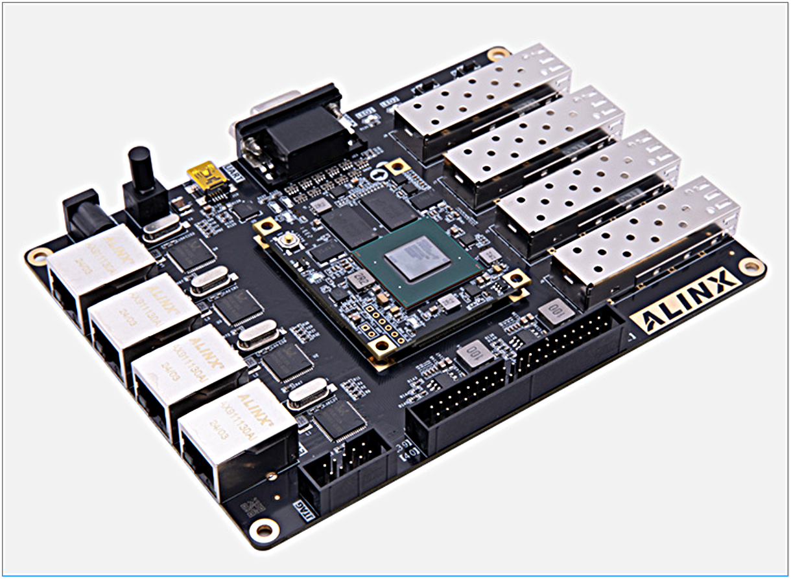
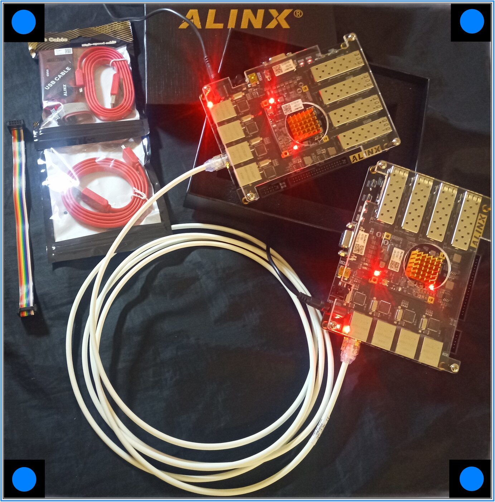
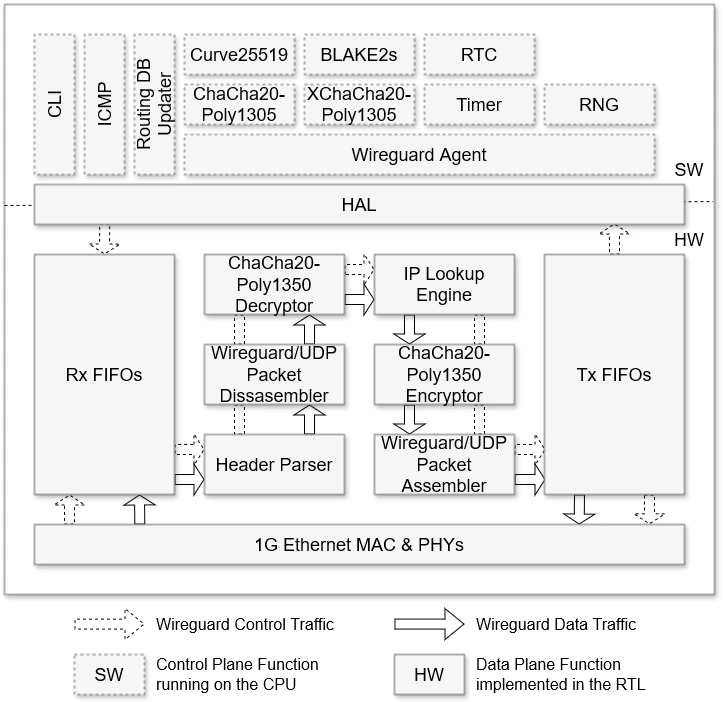
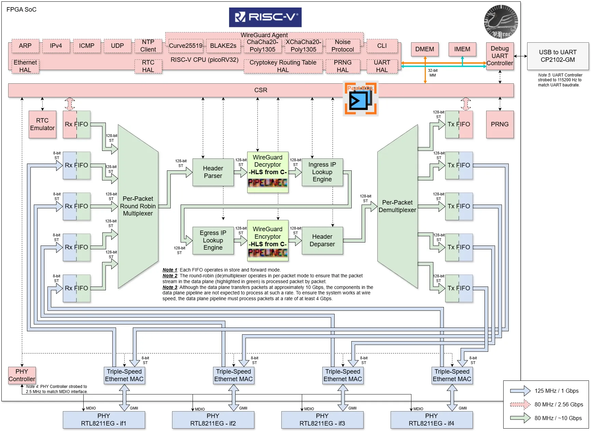
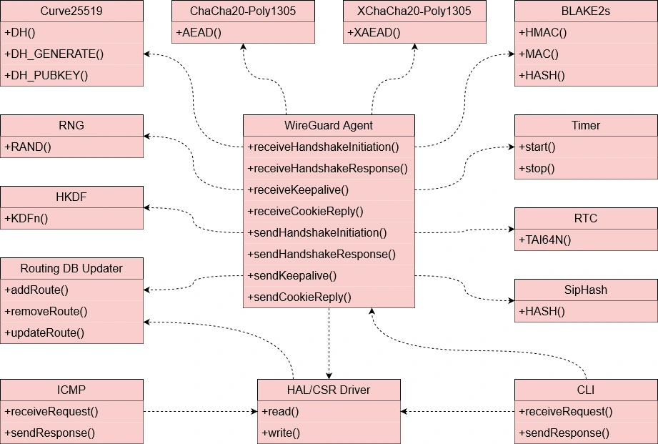
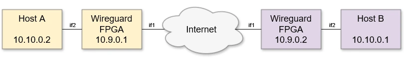
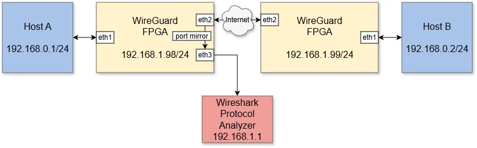
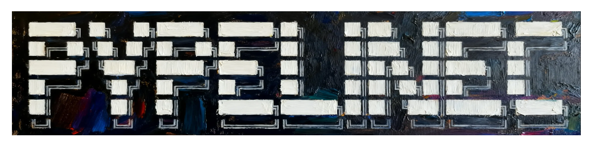
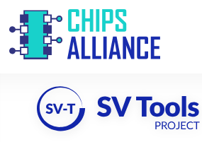

<!--
SPDX-FileCopyrightText: 2026 Chili.CHIPS*ba

SPDX-License-Identifier: BSD-3-Clause
-->

# Wireguard FPGA
Virtual Private Networks (VPNs) are the central and indispensable component of Internet security. They comprise a set of technologies that connect geographically dispersed, heterogeneous networks through encrypted tunnels, creating the impression of a homogenous private network on the public shared physical medium. 

  
  
  

With traditional solutions (such as OpenVPN / IPSec) starting to run out of steam, Wireguard is increasingly coming to the forefront as a modern, secure data tunneling and encryption method, one that's also easier to manage than the incumbents. Both software and hardware implementations of Wireguard already exist. However, the software performance is far below the speed of wire. The existing hardware approaches are both prohibitively expensive and based on proprietary, closed-source IP blocks and tools.  

This project aims to bridge these gaps with an `open-source, FPGA-based` implementation of Wireguard. It puts to work multiple open-source technologies:

   ⭐ **PipelineC** HLS-like, with its **Pypeline** Python HDL + Sim
 
   ⭐ **PeakRDL** CSR
 
   ⭐ **RISC-V** CPU
 
   ⭐ **VProc** CoSim
 
   ⭐ **OpenXC7** PNR

   ⭐ **SV2V** SystemVerilog-to-Verilog HDL converter
   
and taps into ⭐ **Verilog-Ethernet** open-source IP library in order to compose a coherent hardware-software SOC for secure networking.

## A Glimpse into History 
We have contributed to the **Blackwire** project, which is a 100Gbps hardware implementation of Wireguard switch based on AMD/Xilinx-proprietary AlveoU50 PC-accelerator card (SmartNIC form-factor), and implementable only with proprietary Vivado toolchain. 

While working on the _Blackwire_, we have touched multiple sections, and focused on the novel algorithm for [_Balanced Binary Tree Search_](0.doc/Wireguard/Scalable-Balanced-Pipelined-IPv6-Lookup.pdf) of IP tables. However, the _Blackwire_ hardware platform is expensive and priced out of reach of most educational institutions. Its gateware is written in SpinalHDL, a nice and powerfull but a niche HDL, which has not taken roots in the industry. While _Blackwire_ is now released to open-source, that decision came from their financial hardship -- It was originaly meant for sale. Moreover, the company behind it is subject to disputes and obligations that bring into question the legality of ownership over the codebase they "donated" to the open source community. 

## Back to the Future
To make the hardware Wireguard truly accessible in the genuine spirit of open-source movement, this project implements it:
-	for an [inexpensive hardware platform](https://www.en.alinx.com/Product/FPGA-Development-Boards/Artix-7/AX7201.html) with four 1000Base-T ports
-	in a self-sufficient way, i.e. w/o requiring PC host
-	using a commodity Artix7 FPGA
-	which is supported by open-source tools  
-	and with all gateware written in the ubiquitous Verilog / System Verilog

  
  

## References

**[Ref1]** Wireguard implementations in software:
  - [Netbird](https://github.com/netbirdio/netbird)
  - [Tailscale](https://tailscale.com/blog/more-throughput)
  - [Linux Kernel](https://thenewstack.io/Wireguard-vpn-protocol-coming-to-a-linux-kernel-near-you)
  
**[Ref2]** 100Gbps [_Blackwire_](https://github.com/brightai-nl/BrightAI-Blackwire) Wireguard 
  
**[Ref3]** [Corundum](https://github.com/corundum/corundum), open-source FPGA-NIC platform 
  
**[Ref4]** [ChaCha20-Poly1305](https://github.com/mrdcvlsc/ChaCha20-Poly1305) open-source Crypto RTL 
  
**[Ref5]** Cookie Cutter [SOC](https://github.com/chili-chips-ba/openXC7-TetriSaraj)

**[Ref6]** [RISC-V ISS](https://github.com/wyvernSemi/riscV/tree/main/iss)

**[Ref7]** [10Gbps Ethernet Switch](https://github.com/ZipCPU/eth10g)
  
**[Ref8]** [OpenXC7](https://github.com/openXC7) open-source tools for Xilinx Series7

**[Ref9]** [Alex's Ethernet Stack](https://github.com/alexforencich/verilog-ethernet)

**[Ref10]** [High-performance Switches and Routers](https://books.google.ba/books?id=kzstoFdvZ2sC&printsec=frontcover&redir_esc=y#v=onepage&q&f=false)

**[Ref11]** [Amina's ADASEC-SDN](https://github.com/etf-tk-sdn/ADASEC-SDN)

**[Ref12]** [opencryptohw](https://github.com/IObundle/iob-soc-opencryptohw)

**[Ref13]** [Pypeline Native Sim](https://github.com/JulianKemmerer/PipelineC/blob/master/examples/pypeline/chacha20poly1305/pypeline_sim_and_wireguard.md)

# Project Outline

## Scope
The Phase1 (This!) is primarily **Proof of Concept**, i.e. not full-featured, and definitely not a deployable product. It is envisoned as a mere on-ramp, a springboard for future build-up and optimizations.

The Phase2 continuation project is therefore also in the plans, to maximize efficiency and overall useability, such as by increasing the number of channels, facilitating management with GUI apps, or something else as identified by the community feedback.

## Recognized Challenges 
1) HW/SW partitioning, interface, interactions and workload distribution
    - While, contrary to _Blackwire_, we don’t rely on an external PC connected via PCIE, we will still have an on-chip RISC-V CPU with intricate hardware interface and significant Embedded Software component that controls the backbone of wire-speed datapath

2) HW/SW co-development, integration and debugging
    - Standard simulation is impractical for the project of this size and complexity. We therefore intend to put to test and good use the very promissing new [VProc ISS](https://www.linkedin.com/posts/simon-southwell-7684482_riscv-iss-embeddedsoftware-activity-7217116220754411520-08xZ?utm_source=share&utm_medium=member_desktop) [Ref6]
    - It’s also impractical and expensive to provide full test systems with real traffic generators and checkers to all developers. We therefore plan to rent some space for a central lab that will host two test systems, then provide remote access to all developers

3)	Real-life, at-speed testing
4)	Extent of open-source tools support for SystemVerilog and all needed FPGA primitives and IP functions
5)	QOR of the (still maturing) open-source tools
    - _Blackwire_ used commercial, AMD/Xilinx-proprietary Vivado toolchain, as well as high-end Alveo U50 FPGA silicon. Even then, they ran into multiple timing closure, utilization and routing congestion challenges.
6) Financial resources
    - Given that this is a complex, multi-disciplinary dev effort, the available funding may not be sufficient to bring it to completion. _Blackwire_, despite a larger allocated budget, ended up with funding crisis and abrupt cessation of dev activities.

# Design Blueprint
## HW/SW Partitioning
Since the WireGuard node essentially functions as an IP router with WireGuard protocol support, we have decided to design the system according to a two-layer architecture: a control plane responsible for managing IP routing processes and executing the WireGuard protocol (managing remote peers, sessions, and keys), and a data plane that will perform IP routing and cryptography processes at wire speed. The control plane will be implemented as software running on a soft CPU, while the data plane will be fully implemented in RTL on an FPGA.

  

 
In the HW/SW partitioning diagram, we can observe two types of network traffic: control traffic, which originates from the control plane and goes toward the external network (and vice versa), and data traffic, which arrives from the external network and, after processing in the data plane, returns to the external network. Specifically, control traffic represents WireGuard protocol handshake messages, while data traffic consists of end-user traffic, either encrypted or in plaintext, depending on the perspective.

## Hardware Architecture and Theory of Operation

  

The hardware architecture essentially follows the HW/SW partitioning and consists of two domains: a soft CPU for the control plane and RTL for the data plane.

The soft CPU is [eduBOS5](1.hw/ip.cpu/cpu.EDUBOS5/README.md) (default; its [#61](https://github.com/chili-chips-ba/wireguard-fpga/issues/61) fix passes the [`UART_BUS_STRESS`](4.sim/README.md#uart-bus-master-test-uart_bus_stress) simulation, hardware check pending) or PicoRV32, picked in [`1.hw/top.filelist`](1.hw/top.filelist). It runs from on-chip memory: 64 kB IMEM and 64 kB DMEM ([`1.hw/top.sv`](1.hw/top.sv)). This memory serves only the control plane and does not store packets. The connection between the control and data planes is established through a CSR-based HAL.

The data plane consists of several IP cores, including data plane engine (DPE) and supporting components, which are listed and explained in the direction of network traffic propagation. Stages marked (planned) are not built yet; today the DPE is multiplexer -> pass-through dummy switch -> demultiplexer ([`1.hw/top.filelist`](1.hw/top.filelist)).
- _PHY Controller_ - initial configuration of Realtek PHYs and monitoring link activity (link up/down events)
- _1G MAC_ - execution of the 1G Ethernet protocol (framing, flow control, FCS, etc.)
- _Rx FIFOs_ - clock domain crossing, bus width conversion, and store & forward packet handling
- _Per-Packet Round Robin Multiplexer_ - servicing Rx FIFOs on a per-packet basis using a round-robin algorithm
- _Header Parser_ (planned) - extraction of WireGuard-related information from packet headers (IP addresses, UDP ports, WireGuard message type, peer ID, etc.)
- _Wireguard/UDP Packet Disassembler_ (planned) - decapsulation of the payload from the Wireguard data packet for decryption of tunneled traffic
- _ChaCha20-Poly1305 Decryptor_ (planned) - decryption and authentication of tunneled traffic
- _IP Lookup Engine_ (planned) - routing/forwarding table lookup, mapping packets to the appropriate WireGuard peer, and making packet accept/reject decisions
- _ChaCha20-Poly1305 Encryptor_ (planned) - encryption and authentication of traffic to be tunneled
- _Wireguard/UDP Packet Assembler_ (planned) - encapsulation of the encrypted packet into a WireGuard data packet for tunneling to the remote peer
- _Per-Packet Demultiplexer_ - forwarding packets to Tx FIFOs based on packet type and destination
- _Tx FIFOs_ - clock domain crossing, bus width conversion, and store & forward packet handling

_ChaCha20-Poly1305 Encryptor/Decryptor_ are using [RFC 8439's](https://datatracker.ietf.org/doc/html/rfc8439) AEAD (Authenticated Encryption Authenticated Data) construction based on [ChaCha20](http://cr.yp.to/chacha.html) for symmetric encryption and [Poly1305](http://cr.yp.to/mac.html) for authentication.

The details of hardware architecture can be found in the [README.md](./1.hw/README.md) in the `1.hw/` directory.

## Software Architecture and Theory of Operation

  

The conceptual class diagram provides an overview of the components in the software part of the system without delving into implementation details. The focus is on the WireGuard Agent, which implements the protocol's handshake procedures, along with the following supplementary components:
- [Curve25519](http://cr.yp.to/ecdh.html) - an ECDH algorithm implementation for establishing a shared secret using a public-private key pair between two remote parties connected via an insecure channel, such as the Internet
- ChaCha20-Poly1305 - an AEAD algorithm implementation for encryption and authentication of static keys and nonce values to prevent replay attacks
- XChaCha20-Poly1305 (planned) - a XAEAD algorithm implementation for encrypting and authenticating nonce values in Cookie Replay messages to mitigate potential DoS attacks
- [BLAKE2s](https://www.blake2.net) - an implementation of the BLAKE2s hash function for MAC authentication and keyed hashing, per [RFC7693](https://datatracker.ietf.org/doc/html/rfc7693)
- RNG - a random number generator used to initialize the DH key generator and generate peer identifiers
- Timer - cycle-counter timer; rekey, retry, and keepalive timers are planned
- [HKDF](https://eprint.iacr.org/2010/264) - an implementation of the algorithm for expanding the ECDH result
- RTC (planned) - a real-time clock used to generate the TAI64N timestamp
- [SipHash](https://en.wikipedia.org/wiki/SipHash) (planned) - a simple non-cryptographic function used for implementing a hashtable for fast lookup of decrypted static public keys of remote peers
- Routing DB Updater - a subsystem for maintaining the cryptokey routing table content and deploying it to the data plane via the HAL/CSR interface
- ICMP - implementing basic ICMP protocol functions (echo request/reply, TTL exceeded, etc.)
- CLI - a USB/UART-based command-line interface for configuring the WireGuard node (setting the local IP address, remote peer IP addresses, network addresses, keys, etc.)
- HAL/CSR Driver - a CSR-based abstraction for data plane components with an interface for reading/writing the corresponding registers

The details of software architecture can be found in the [README.md](./2.sw/README.md) in the `2.sw/` directory.

## HW/SW Working Together as a Coherent System
To illustrate the operation of the system as a whole, we have prepared a step-by-step analysis of packets processing based on the capture of real WireGuard traffic. The experimental topology consists of four nodes:
- 10.10.0.2 - the end-user host at site A
- 10.9.0.1 - WireGuard peer A
- 10.9.0.2 - WireGuard peer B
- 10.10.0.1 - the end-user host at site B

  

The detailed analysis can be found in the [README.md](./1.hw/README.md#hwsw-working-together-as-a-coherent-system) in the `1.hw/` directory.

## Pypeline Intro

The ChaCha20-Poly1305 AEAD core is also written in [Pypeline](https://github.com/JulianKemmerer/PipelineC#what-is-pypelinec), the Python front-end of PipelineC: hardware design and cycle-exact simulation in plain Python, RFC 8439-conformant and verified on silicon.

  

Details: [3.build/pypeline_build](3.build/pypeline_build/README.md).

## Simulation Test Bench

The [Wireguard FPGA test bench](4.sim/README.md) aims to have a flexible approach to simulation which allows a common test environment to be used whilst selecting between alternative CPU components, one of which uses the [_VProc_ virtual processor](https://github.com/wyvernSemi/vproc) co-simulation element. This allows simulations to be fully HDL, with a RISC-V processor RTL implementation (eduBOS5 or PicoRV32), or to co-simulate software using the virtual processor, with a significant speed up in simulation times. The test bench has the following features:

* A [_VProc_](https://github.com/wyvernSemi/vproc) virtual processor based [`soc_cpu.VPROC`](4.sim/models/README.md#soc_cpuvproc) component
  * [Selectable](4.sim/README.md#auto-selection-of-soc_cpu-component) between this or an RTL softcore
  * Can run natively compiled test code
  * Can run the application compiled natively with the [auto-generated co-sim HAL](3.build/README.md#csr-hal-compilation)
  * Can run RISC-V compiled code using the [rv32 RISC-V ISS model](4.sim/models/rv32/README.md)
* Uses a C [sparse memory model](https://github.com/wyvernSemi/mem_model)
  * An [HDL component](4.sim/models/cosim/README.md) instantiated in logic gives logic access to this memory
  * An API is provided to _VProc_ running code for direct access
* The [_udpIpPg VIP_](https://github.com/wyvernSemi/udpIpPg) is used to drive the logic's four ethernet ports in a four port [`bfm_ethernet`](4.sim/models/README.md#the-bfm_ethernet-ethernet-driver-module) block.
  * An [MDIO slave interface](4.sim/models/README.md#the-bfm_phy_mdio-mdio-slave-driver-module) is also provided that maps *mem_model* memory areas to the registers with instantiated *mem_model* components

The figure below shows an oveview block diagram of the test bench HDL.

   

More details on the architecture and usage of the Wireguard test bench can be found in the [README.md](4.sim/README.md) in the `4.sim` directory.

## Co-simulation HAL

The control and status register (CSR) RTL and the firmware's register header are [auto-generated](3.build/README.md#csr-hal-compilation) from one SystemRDL file, [`3.build/csr_build/csr.rdl`](3.build/csr_build/csr.rdl), with [`peakrdl`](https://peakrdl-cheader.readthedocs.io/en/latest/). The firmware reaches every register through four macros in `csr_regs.h`: `CSR_REG32`, `CSR_GET`, `CSR_SET`, `CSR_RMW`. They are loads and stores on the RISC-V core, and *VProc* bus cycles when the same firmware is compiled for the host in co-simulation ([4.sim](4.sim/README.md#co-simulation-hal)). One header and one source for both, with no generator beyond `peakrdl`.

### CSR access, step by step

| | HAL | One register access | Writing a field | `.text` | `.bss` |
|---|---|---|---|---|---|
| until 2026-10 | `new csr_vp_t()`: a tree of C++ objects on the heap, one per register | loads 2-3 pointers, then the access | read-modify-write of the whole register | 28,308 B | 37,424 B |
| 2026-10 | `csr_hw.h` (generated): each class laid out like its registers | one load or store | a byte or half-word store when the field fills whole bytes | 23,308 B | 3,112 B |
| now | `csr_regs.h` macros on the `peakrdl` header | one load or store | the same; a read-modify-write stores only the field's bytes | 24,452 B | 3,108 B |

The last step drops the generated C++ class trees (`csr_hw.h`, `csr_cosim.h` and their generator) for one header that serves both the hardware and the co-simulation, as on [openPCIE](https://github.com/chili-chips-ba/openPCIE/blob/main/5.sim/README.md#co-simulation-hal). It costs 1.1 kB of code.

## Build process
The details of the build process can be found in the [README.md](3.build/README.md) in the `3.build/` directory.

## Lab Test and Validation Setup
The figure illustrates a test topology consisting of two remote hosts, A and B, connected in a VPN implemented using two WireGuard-FPGA nodes interconnected over a public network. An additional node in the public network is included to demonstrate traffic encryption. Detailed instructions for configuring the WireGuard-FPGA nodes are provided in [README.md](5.test/README.md) in the `5.test/` directory.

  

---
# Project Execution Plan / Tracking

This project in the final wrap up phase. The checkmarks below indicate status. Until all checkmarks are in place, anything you get from here is w/o guaranty -- Use at own risk, as you see fit, and don't blame us if it is not working 🌤️

## Take1
**Board bring up. In-depth review of Wireguard ecosystem and prior art. Design Blueprint**

While the board we're using is low cost, it is also not particularly known in the open-source community. We certainly don’t have prior experience with it. In this opening take we will build a solid foundation for efficient project execution. Good preparation is crucial for a smooth run. We thus seek to first _`understand and document what we will be designing: SOC Architecture, Datapath Microarchitecture, Hardware/Software Partitioning, DV and Validation Strategy`_. 

Getting a good feel for our Fmax is also a goal of this take. Artix-7 does not support High-Performance (HP) I/O. Consequently, we cannot push its I/O beyond 600MHz, nor its core logic beyond 100 MHz. 

- ✅ Familiarization with HW platform
  - Create our first FPGA program that blinks LEDs
  - Verify pinouts and connectivity using simple test routines
  - Generate a few Ethernet test patterns 

- ✅ Familiarization with SW platform
  - Initial bring up of embedded CPU within a _cookie-cutter_ SOC, such as [Ref5]
  - Design and test a simple SW interface to rudimentary HW Ethernet datapath

- ✅ Detailed analysis and comparisons of:
  - Wireguard [White Papers](https://www.ndss-symposium.org/wp-content/uploads/2017/09/ndss2017_04A-3_Donenfeld_paper.pdf)
  - existing implementations in software [Ref1]
  - vs. _Blackwire_ hardware implementation [Ref2]
  - [cryptographic algorithms](https://eprint.iacr.org/2018/080.pdf) used for Wireguard, esp. **ChaCha20** for encryption, **Poly1305** for authentication [Ref4] and, to a lesser extent, _Curve25519_ for key exchange and _blake2_ for hashing
  
- ✅ Identification and assimilation of prior art and building IP blocks, in particular **Corundum** [Ref3] and, to a lesser extent, _10GE Switch_ [Ref7] 

- ✅ Architecture/uArch Design. HW/SW Partitioning. Verification Plan

- ✅ Creation of sufficient initial documentation for project divide-and-conquer across a multi-disciplinary team of half a dozen developers

## Take2
**Implementation of a basic, statically pre-configured Wireguard link**

It it in this take that we start creating hardware Datapath and hardening Wireguard encryption protocols, all using Vivado and Xilinx primitives.

- ✅ Integration of collected RTL blocks into a coherent HW system that implements the basic Wireguard datapath for a handful of manually pre-configured channels.
  - Corundum FPGA-based NIC and platform for opensource Ethernet development [Ref3]
  -	IP Core for **ChaCha20-Poly1305** [Ref4] -- Definitely in hardware from the get-go
    - https://github.com/Goshik92/FpgaCha
    - https://github.com/secworks/ChaCha20-Poly1305
    - https://github.com/FPGA-House-AG/ChaCha20Poly1305
    - https://github.com/JulianKemmerer/PipelineC/tree/master/examples/chacha20poly1305

  - _Curve25519_ module for key exchange -- Likely in software at this point
    - https://github.com/kazkojima/x25519-fpga
  - _blake2_ module for hashing (we'll most likely do it in software)
    - https://github.com/secworks/blake2
      
- ✅ Timing closure. Resolution of FPGA device utilization and routing congestion issues
- [ ] Creation of cocoTB DV in the CI/CD environment, and representative test cases for datapath simulation (cocoTB tests run locally in `3.build/pypeline_build`; CI runs only lint and Verible)

## Take3
**Development and integration of embedded management software (Control Plane)**

This work package is about hardware/software codesign and integration. The firmware will run on a soft RISC V processor, inside the FPGA. Our vanilla SOC is at this point starting to be customized to Wireguard needs. This work can to some extent go on in parallel with hardware activities of Take2. 

- ✅ SW design for on-chip processor (Part 1)
  - Code is to be written in the bare-metal C with, as necessary, a few sections in Assembly
  - SW is responsible for configuration and management of hardware blocks
  - SW must not participate in the bulk datapath transfers
  - SW may however intercept the low-frequency management packets

- ✅ SW design for on-chip processor (Part 2)
  - KMM function -- Key Management Module

- ✅ HW/SW Integration

## Take4
**VPN Tunnel: Session initialization, maintenance, and secure closure**

This is about managing the bring-up, maintenance and tear-down of VPN tunnels between two devices.
- [ ] Session Initialization: Starting the handshake process to establish secure communication with another device
- [ ] Session Maintenance: Keeping the session active through the regular exchange of control messages, which allows detection and recovery from problems such as connection interruptions
- [ ] Session Closure: Securely close the VPN tunnel when communication is no longer needed, ensuring that all temporary keys and sensitive data are deleted

## Take5
**Testing, Profiling and Porting to OpenXC7**

- [ ] Functional testing on the real system. Does it work as intended? Bug fixes

- [ ] Performance testing. HW/SW profiling, updates and enhancements to ensure the design indeed operates at close to the wire speed on all preconfigured channels

- ✅ Porting to openXC7 [Ref8] using [SV2V](https://github.com/zachjs/sv2v)
  - This is challenging, as openXC7 has thus far been crashing for NES SV
  - Ported to openXC7 v1.0.0 (Yosys 0.69 + nextpnr-himbaechel) on 2026-10-21, now with `read_slang` instead of sv2v ([3.build](3.build/README.md#hw-compilation---openxc7))

- ✅ Timing closure with openXC7 v1.0.0 (2026-10-21): PicoRV32 at seed 3, eduBOS5 at seed 1; margins are thin ([#48](https://github.com/chili-chips-ba/wireguard-fpga/issues/48))
  - This is definitely challenging, given that openXC7 is currently without accurate timing-driven STA

- ✅ Filing bug tickets with open source developers for issues found in their tools, supporting them all the way to the resolution
      
- ✅ Creation and maintenance of an attractive and well-documented Github repo, to entice community interest
      
- ✅ Ongoing documentation updates and CI/CD script maintenance to keep it valid in the light of inevitable design mutations compared to the original Design Blueprint.

## Take6 (time-permitting Bonus)
**Flow control module for efficient and stable VPN tunnel data management**

The objective of this optional deliverable is to ensure stable and efficient links, thus taking this project one step closer to a deployable product.

- [ ] Develop software components for management of data flow within VPN tunnels

### Acknowledgements
We are grateful to **NLnet Foundation** for their sponsorship of this development activity.

   
   

This project was funded through the NGI0 Entrust Fund, a fund established by NLnet with financial support from the European Commission's Next Generation Internet programme, under the aegis of DG Communications Networks, Content and Technology under grant agreement No 101069594.

The **wyvernSemi**'s wisdom and contribution made a great deal of difference -- Thank you, we are honored to have you on the project.

   

If it was not for **Julian Kemmerer's** unreserved support helping us move our two cryptography blocks from C to gates, be it by guiding and mentoring, or by doing it himself, the meat of this project would not have been so easily pushed through to hardware using `PipelineC`. Thank you Mr.OpensourceHLS 🙏. 

 

 

**openXC7**, with **Yosys** at its core, turns RTL into a loadable FPGA bitfile. **PeakRDL** turns our SystemRDL file into CSR RTL+headers+RegMap docs. **Verilator**, **slang** and **Verible** keep our RTL clean, and Verilator runs the SoC co-simulation. **cocotb** with **GHDL** verifies the generated crypto cores. **[sv2v](https://github.com/zachjs/sv2v)** converted our SystemVerilog for the first openXC7 port, and is still there as `FRONTEND=sv2v`. But, that's not everything that made this project possible -- Thank you all for these wonderful opensource tools :sparkles:.

 
  
  

  
  

  
  
  
  
  
  
  
  
  
  

### Community Outreach
- [2025-12-11](https://www.linkedin.com/posts/chili-chips_wireguard-fpga-opensource-activity-7404799997201833985-Hh-j?utm_source=share&utm_medium=member_desktop&rcm=ACoAAAJv-TcBSi_5ff0VNMrInrT-xg44YF3jnyU)
- [2025-10-12, daily.dev](https://daily.dev/posts/chili-chips-ba-wireguard-fpga-full-throttle-wire-speed-hardware-implementation-of-wireguard-vpn-u-wsf6uxyf1) (from Hacker News)
- [2025-10-12](https://www.linkedin.com/pulse/wireguard-fpga-advanced-co-simulation-verification-case-southwell-z64ce)
- [2025-06-07](https://www.linkedin.com/posts/simon-southwell-7684482_had-a-great-time-at-the-fpga-conference-europe-activity-7347534737554505729-pWYJ?utm_source=share&utm_medium=member_desktop&rcm=ACoAAAJv-TcBSi_5ff0VNMrInrT-xg44YF3jnyU)
- [2025-05-17](https://www.linkedin.com/posts/chili-chips_opensource-wireguard-fpga-activity-7329738780876197888-ljJR?utm_source=share&utm_medium=member_desktop&rcm=ACoAAAJv-TcBSi_5ff0VNMrInrT-xg44YF3jnyU)
- [2025-01-18](https://www.linkedin.com/feed/update/urn:li:activity:7283512029850533888?commentUrn=urn%3Ali%3Acomment%3A%28activity%3A7283512029850533888%2C7286441731925966848%29&replyUrn=urn%3Ali%3Acomment%3A%28activity%3A7283512029850533888%2C7286511091923202048%29&dashCommentUrn=urn%3Ali%3Afsd_comment%3A%287286441731925966848%2Curn%3Ali%3Aactivity%3A7283512029850533888%29&dashReplyUrn=urn%3Ali%3Afsd_comment%3A%287286511091923202048%2Curn%3Ali%3Aactivity%3A7283512029850533888%29)
- [2024-10-27](https://www.linkedin.com/posts/simon-southwell-7684482_riscv-iss-embeddedsoftware-activity-7256311551178027008-1nlZ?utm_source=share&utm_medium=member_desktop)
- [2024-09-19](https://www.linkedin.com/posts/chili-chips_fpga-cpu-ethernet-activity-7242729037771522048-as-C?utm_source=share&utm_medium=member_desktop)

### Community Involvement

Feel like helping opensource VPN community grow better and larger?! See [Contributions](CONTRIBUTING.md).

Don't feel shy to reach out and ask for help ===> .

--------------------

### RTL Coding Rules

New RTL follows our [RTL coding rules](1.hw/README.md#rtl-coding-rules), as in [openPCIE](https://github.com/chili-chips-ba/openPCIE/blob/main/2.rtl/README.md#rtl-coding-rules) and [openCologne](https://github.com/chili-chips-ba/openCologne/blob/main/7.SerDes/3.iclink-sv/1.hw/README.md#rtl-coding-rules). [Contributions](CONTRIBUTING.md) lists the QA steps every change goes through: lint, format, simulation, build.

--------------------

### GenAI

Our repo may contain elements of work facilitated by the modern GenAI tools , used under strict guidance and tight supervision of the blood-and-flesh developers, and solely as suggestions.

In the end, it is us, the human devs, who are fully responsible for any shortfalls you may uncover while tapping into repo resources.

--------------------
#### End of Document
